# 文件系统实现与崩溃一致性：从块设备到日志

> **课程**：2026 春季学期《操作系统原理》  
> **讲师**：蒋炎岩（jyy）  
> **官方课程主页**：<https://jyywiki.cn/OS/2026/>  
> **官方讲义**：<https://jyywiki.cn/OS/2026/lect26.md>  
> **视频来源**：[Bilibili BV12EV66bErd](https://www.bilibili.com/video/BV12EV66bErd/)  
> **版权说明**：课程讲义与幻灯片归蒋炎岩所有，采用 [Creative Commons BY-NC 4.0](http://creativecommons.org/licenses/by-nc/4.0/) 许可；本电子书是对课堂讲授的书面化重构，保留出处与许可说明。

## 导语：文件系统就是一个持久化数据结构

*(参考时间: 00:00)*

上一讲已经说明：任何实现目录树与文件读写的对象都可以称为文件系统。

这一讲把它放回块设备：

> 如何在只能按块读写的存储设备上，实现目录树、文件、元数据和持久化？

核心工具只有三个：

```c
bread(block);   // load
bwrite(block);  // store
bsync();        // barrier / durability
```


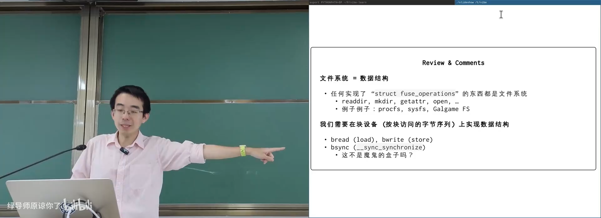

---

## 1. 块设备不是一块简单的字节数组

### 1.1 GPT 分区表

*(参考时间: 00:03)*

一块磁盘常被划分为多个分区：

```text
/dev/nvme0n1
  /dev/nvme0n1p1
  /dev/nvme0n1p2
```

分区信息由 **GPT** 描述：

- GUID Partition Table；
- UEFI 规范的一部分；
- 固件启动时需要解析；
- 头部记录分区位置、大小和类型；
- 尾部通常保存备份副本。

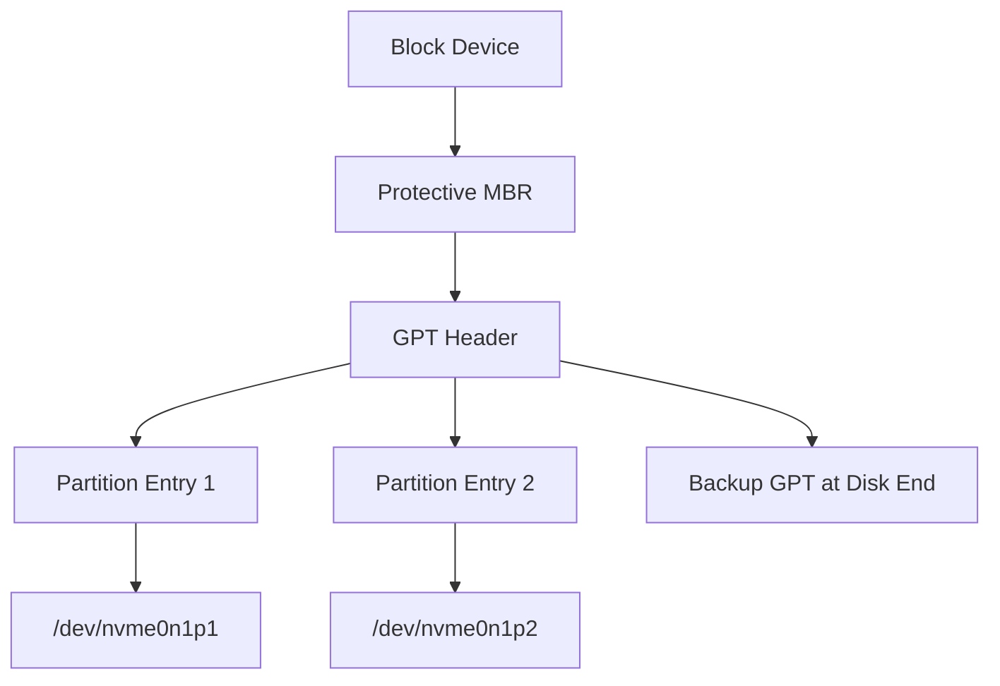

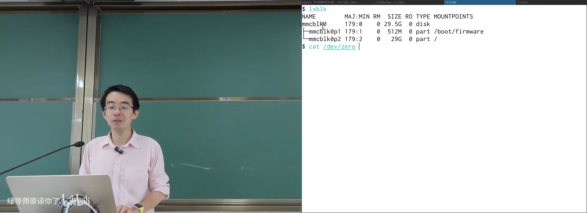

### 1.2 分区只是第一层抽象

*(参考时间: 00:06)*

一个分区还可以继续被虚拟化：

- Loop Device；
- LVM Physical Volume；
- Volume Group；
- Logical Volume；
- NVMe Namespace。

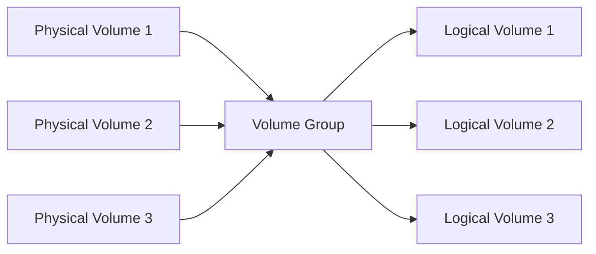

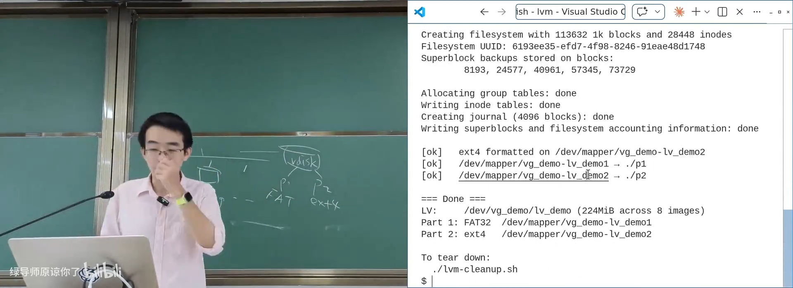

### 1.3 用 strace 打开 LVM

*(参考时间: 00:10)*

LVM 工具表面上是命令，底层仍然是一组系统调用：

```text
open("/dev/loop-control")
ioctl(LOOP_CTL_GET_FREE)
open("/dev/mapper/control")
ioctl(DM_DEV_CREATE)
ioctl(DM_TABLE_LOAD)
ioctl(DM_DEV_SUSPEND)
```

课程强调：这些复杂接口几乎全部通过 `ioctl` 暴露。

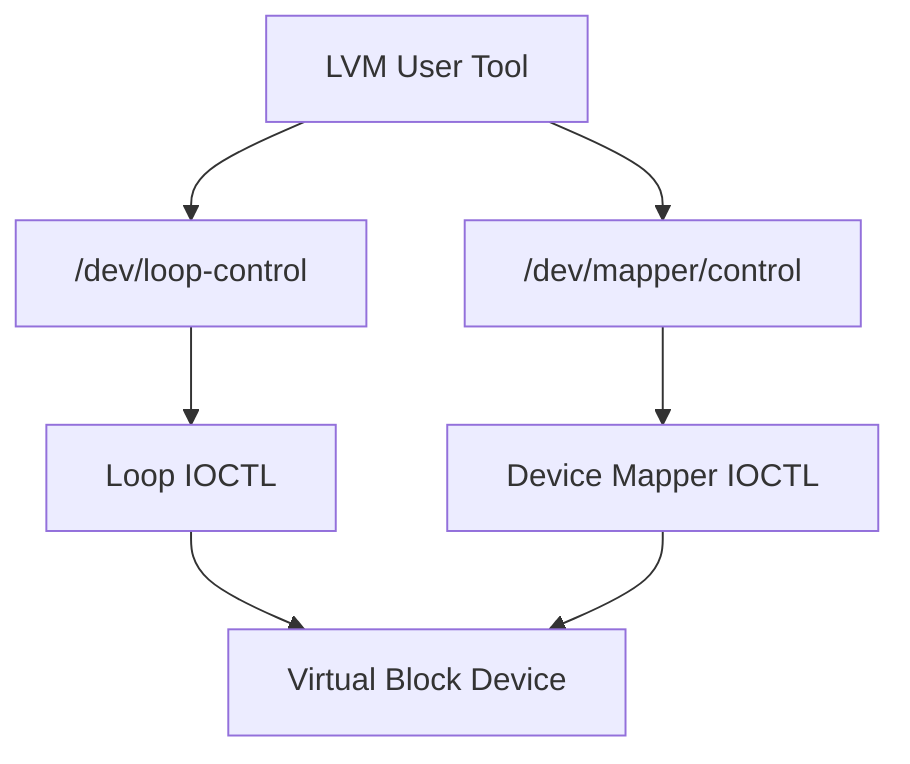

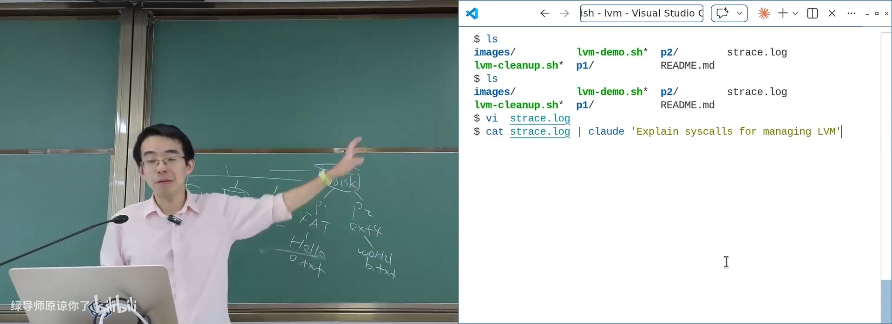

### 1.4 NVMe Namespace

*(参考时间: 00:11)*

NVMe Namespace 像“硬件级 LVM”：

- 一块 SSD 可暴露出多个 namespace；
- 每个 namespace 看起来是独立块设备；
- 上层文件系统只看到最终块数组。

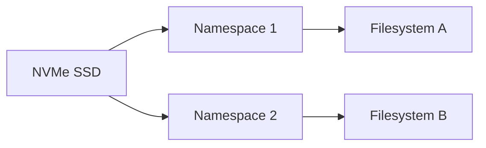

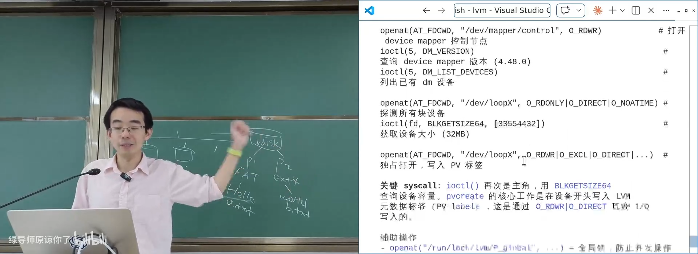

---

## 2. 块访问的代价：缓存与读写放大

### 2.1 更新一个字节可能写多个块

*(参考时间: 00:12)*

追加一个 4 KB 数据块至少涉及：

1. 更新数据块 bitmap；
2. 写入数据块；
3. 更新 inode 的大小、时间和索引。

如果只修改一个字节：

```text
bread(block)
modify byte
bwrite(block)
update metadata
```

还会触发 SSD FTL 的映射表更新，导致更严重的读放大和写放大。

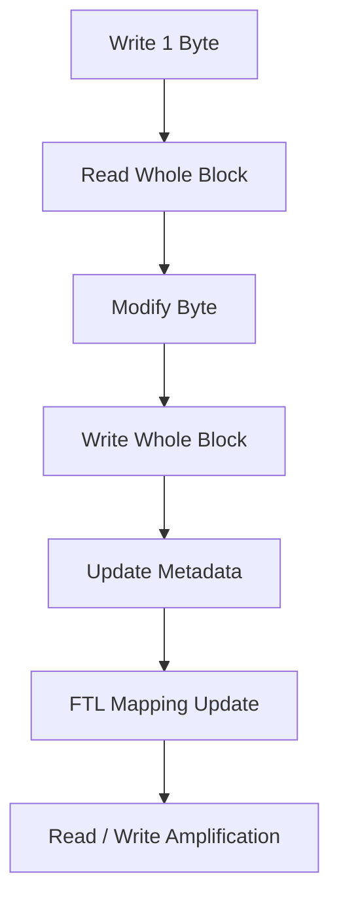

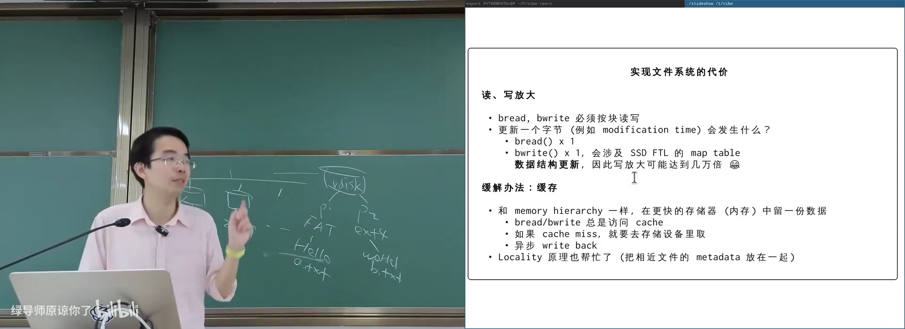

### 2.2 Buffer Cache

*(参考时间: 00:15)*

操作系统在内存中缓存文件系统块：

- `bread` 先查缓存；
- 命中则直接返回；
- 未命中才访问块设备；
- `bwrite` 先写缓存，之后异步回写。

这与内存层次和共享内存非常相似：

```text
load  ≈ bread
store ≈ bwrite
```

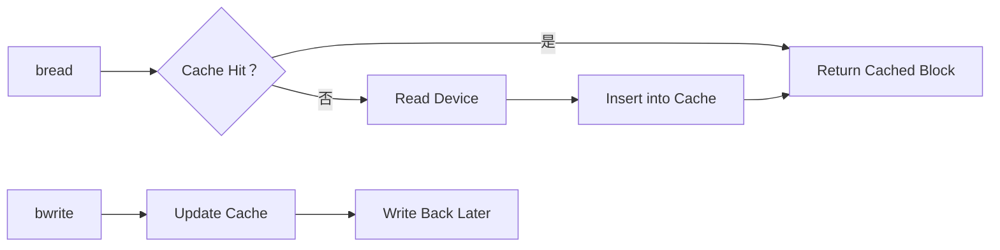

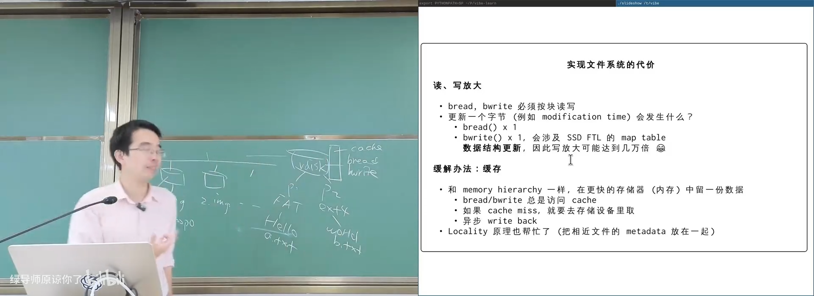

---

## 3. 设计文件系统：先做需求分析

### 3.1 需要持久化什么

*(参考时间: 00:17)*

文件系统需要保存：

- 文件字节数据；
- 文件元数据：名称、大小、权限、时间；
- 目录结构：名称到 inode 的映射；
- 空间分配信息；
- 链接关系。

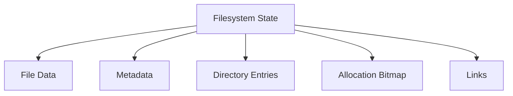

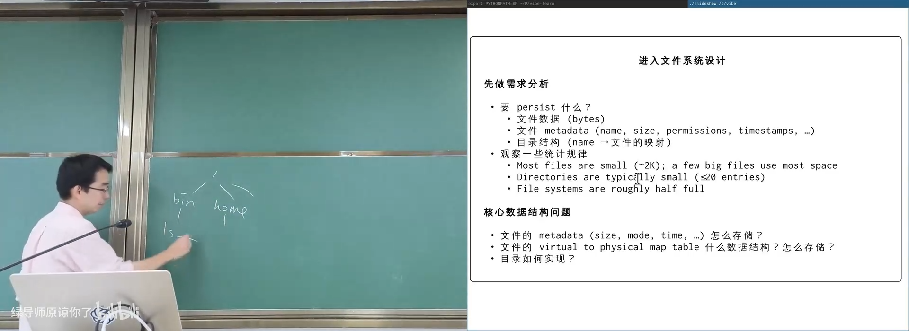

### 3.2 常见 workload 统计

*(参考时间: 00:19)*

经典研究给出一些经验规律：

- 绝大多数文件很小；
- 少量大文件占用多数空间；
- 目录通常不超过几十项；
- 文件系统通常填充到接近一半；
- 元数据访问频率远高于文件内容全量读取。

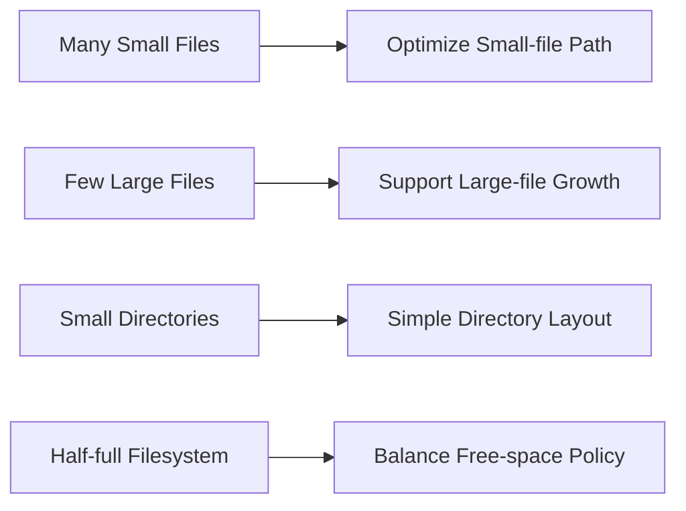

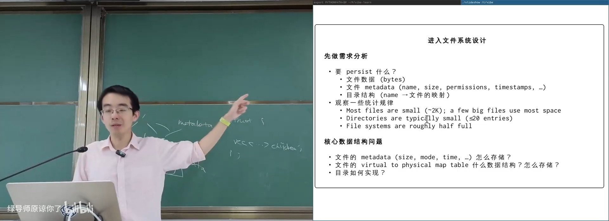

### 3.3 三个核心问题

*(参考时间: 00:21)*

1. 元数据放哪里？
2. 文件块索引使用什么数据结构？
3. 目录如何存储？

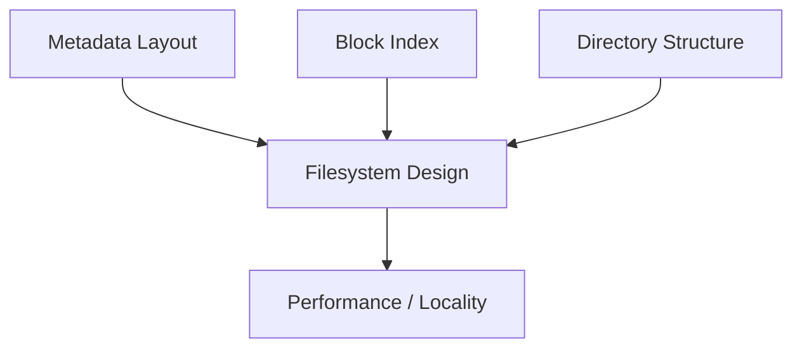

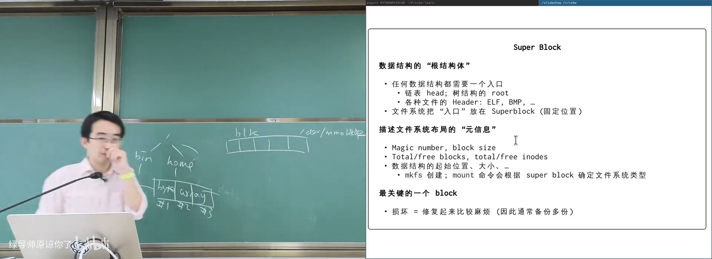

---

## 4. Superblock：数据结构的根

*(参考时间: 00:23)*

所有数据结构都需要入口：

- 链表有 head；
- 树有 root；
- ELF 有 header；
- 文件系统有 Superblock。

Superblock 记录：

- Magic Number；
- Block Size；
- 文件系统总块数；
- 空闲块与 inode 数量；
- 元数据区域位置和大小。

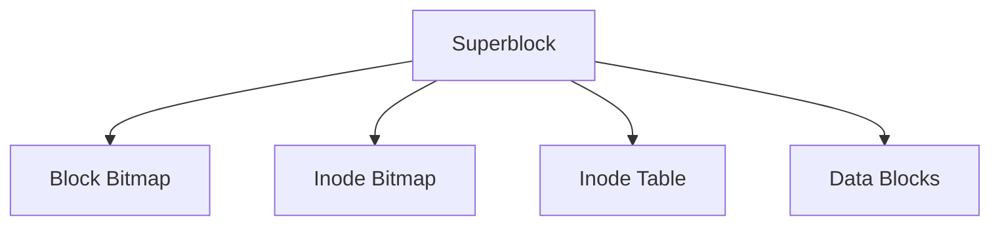

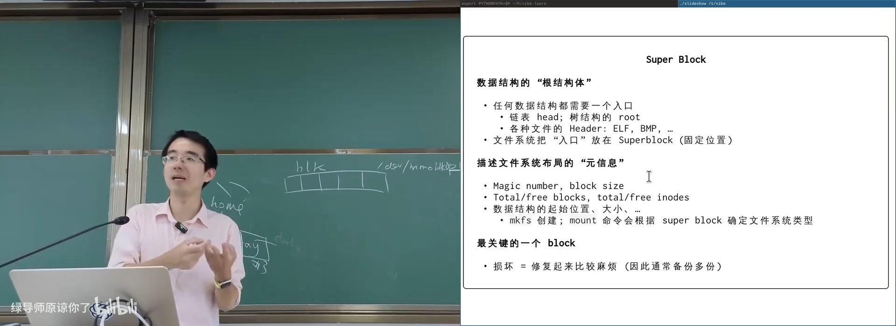

### 4.1 Magic Number 与自动识别

*(参考时间: 00:24)*

`mkfs` 写入 Superblock，`mount` 根据 Magic Number 识别文件系统类型。

如果 Superblock 损坏，文件系统可能无法挂载，因此通常保存多个副本。

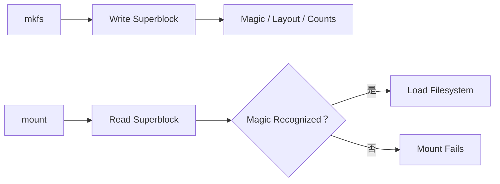

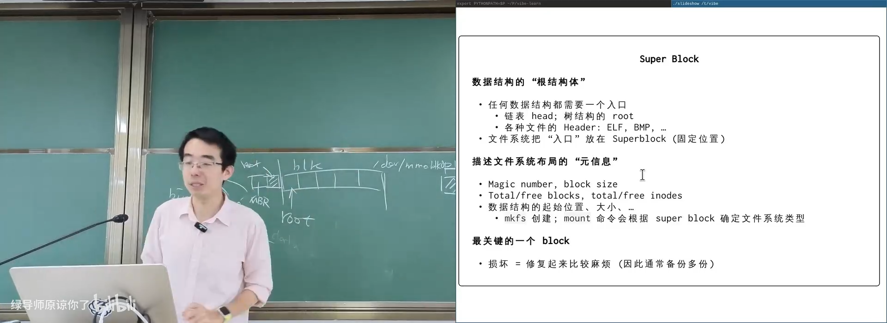

---

## 5. FAT：为极小空间设计的文件系统

### 5.1 FAT 与 Cluster

*(参考时间: 00:26)*

FAT 最早面向容量极小的软盘。

物理扇区可能是 512 B，但文件系统把 `2^k` 个扇区组成一个 **cluster**：

```text
cluster size = 512 B × 2^k
```

FAT 的核心是 cluster 的 `next` 数组。

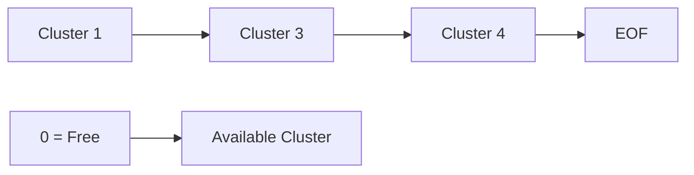

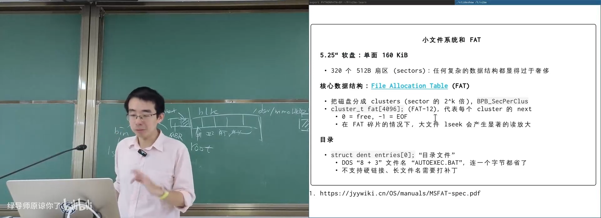

### 5.2 FAT 表就是 next 数组

*(参考时间: 00:29)*

FAT-12 使用 12 位指针：

```text
0      = free
EOF    = cluster chain end
other  = next cluster
```

12 位不是字节整数，因此两个 FAT-12 entry 会打包进 3 个字节：

```text
24 bits = entry[i] (12 bits) + entry[i+1] (12 bits)
```

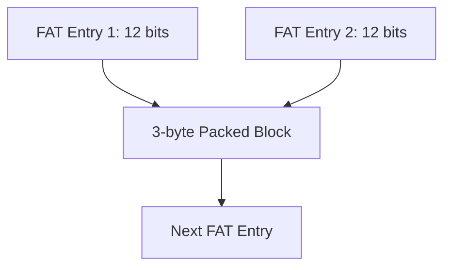

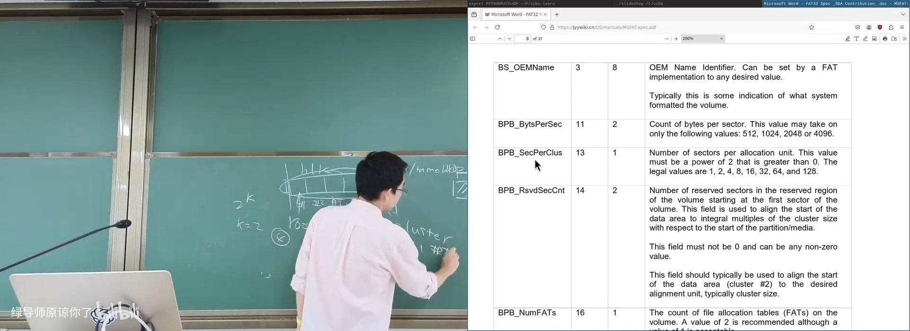

### 5.3 FAT 碎片

*(参考时间: 00:32)*

频繁分配和释放会产生碎片：

```text
file clusters:
  464 → 465 → 466 ... 546

another file:
  2407 ... 2431 → 2511 ... 2587
```

大文件碎片化后：

- cluster 链跳跃；
- FAT entry 本身也可能跨块；
- `lseek` 随机访问需要反复跟踪链；
- 产生严重读放大。

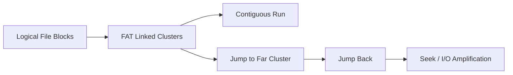

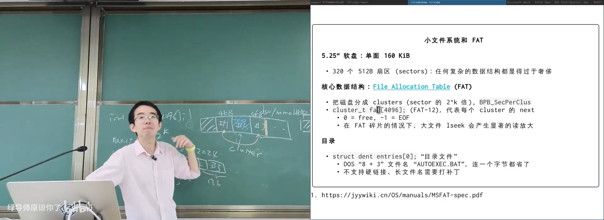

### 5.4 用 mmap 解析 FAT

*(参考时间: 00:35)*

把文件系统镜像映射到内存后，Superblock 就是结构体指针：

```c
struct fat32_header *hdr = mmap(...);
```

随后可以递归扫描目录树。

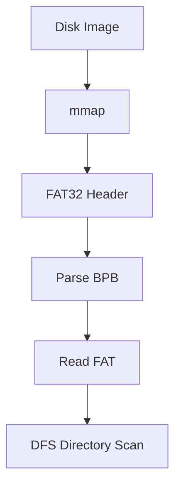

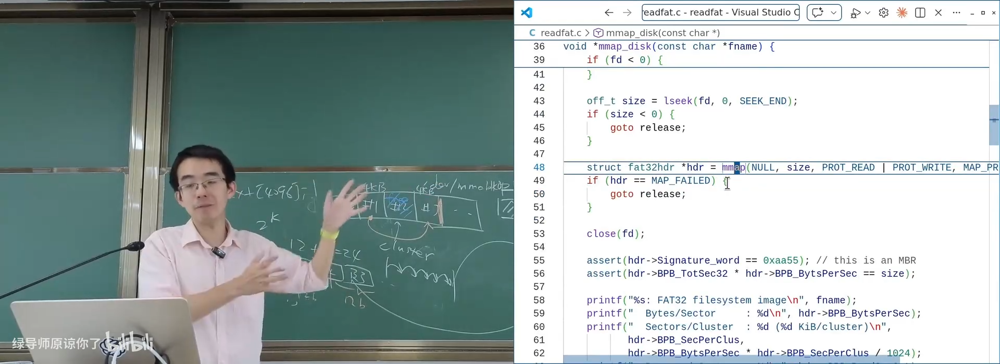

### 5.5 8.3 文件名

*(参考时间: 00:38)*

早期 FAT 目录项固定 11 字节：

```text
8字符文件名 + 3字符扩展名
AUTOEXEC.BAT
```

长文件名通过扩展目录项和 `~1`、`~2` 短名兼容实现。

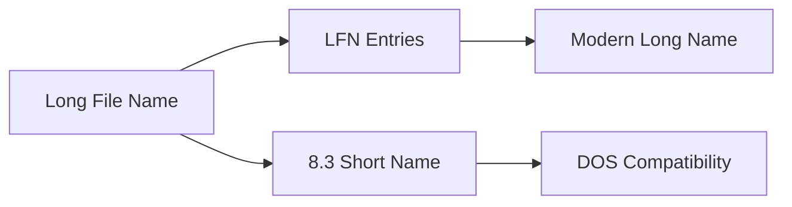

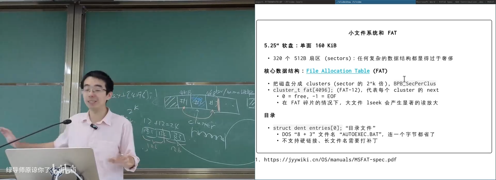

### 5.6 目录也是文件

*(参考时间: 00:40)*

FAT 目录文件由大量 `directory entry` 组成：

```text
name[11]
attributes
first_cluster_high
first_cluster_low
file_size
```

目录文件中保存每个子文件的第一块 cluster。

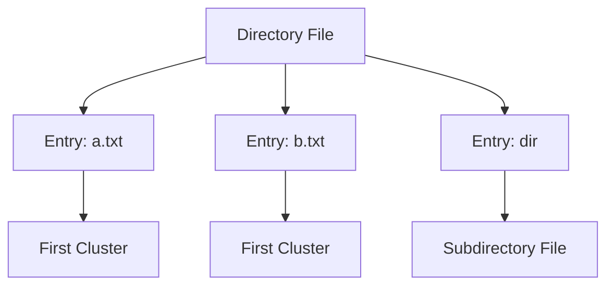

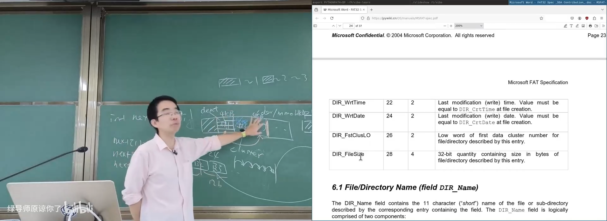

---

## 6. UNIX 文件系统：分离 inode 与目录边

### 6.1 图模型

*(参考时间: 00:41)*

UNIX 文件系统把目录树扩展为图：

- 顶点是文件或目录；
- 目录项是边；
- 边把文件名映射到 inode；
- `.` 和 `..` 也是目录项。

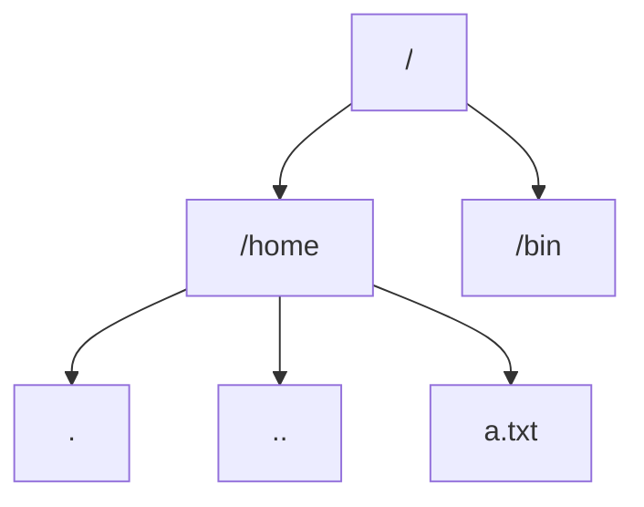

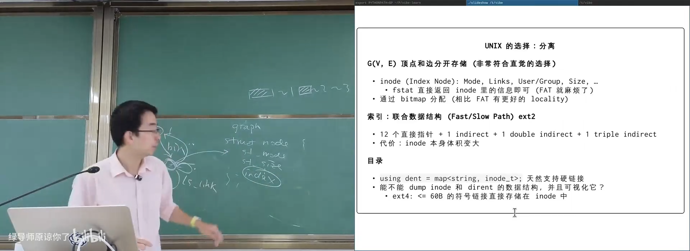

### 6.2 inode

*(参考时间: 00:43)*

顶点元数据保存在 **inode**：

- mode；
- link count；
- uid / gid；
- size；
- timestamps；
- block index。

```c
struct inode {
    mode_t mode;
    nlink_t links;
    uid_t uid;
    gid_t gid;
    off_t size;
    block_t index[...];
};
```


### 6.3 直接块与间接块

*(参考时间: 00:45)*

为兼顾小文件快速访问与大文件容量，UNIX 使用联合索引：

```text
12 direct blocks
1 single indirect
1 double indirect
1 triple indirect
```

```mermaid
flowchart TD
    I["Inode"] --> D["Direct Blocks"]
    I --> S["Single Indirect"]
    S --> S1["Data Blocks"]
    I --> D2["Double Indirect"]
    I --> T["Triple Indirect"]
    D2 --> D21["Indirect Blocks"]
    T --> T1["Indirect Trees"]
```

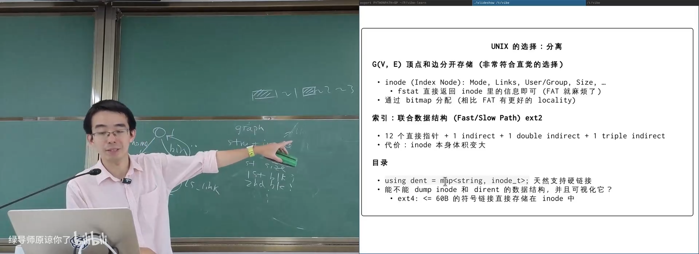

### 6.4 目录项与硬链接

*(参考时间: 00:46)*

目录是：

```text
map<string, inode_number>
```

多个目录项可以指向同一个 inode，这就是硬链接。

```mermaid
flowchart LR
    A["name a.txt"] --> I["Inode 42"]
    B["name alias.txt"] --> I
    I --> D["File Data"]
    I --> L["Link Count = 2"]
```

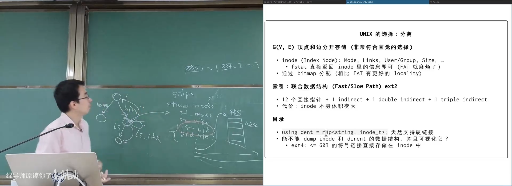

### 6.5 Inline Symlink

*(参考时间: 00:47)*

ext4 对不超过约 60 B 的符号链接：

- 不分配额外数据块；
- 直接把链接目标写进 inode 的块指针区域；
- 节省空间和 I/O。

```mermaid
flowchart TD
    A["Short Symlink Target"] --> B{"<= 60 bytes？"}
    B -- "是" --> C["Store Target Inside Inode"]
    B -- "否" --> D["Allocate Data Block"]
```

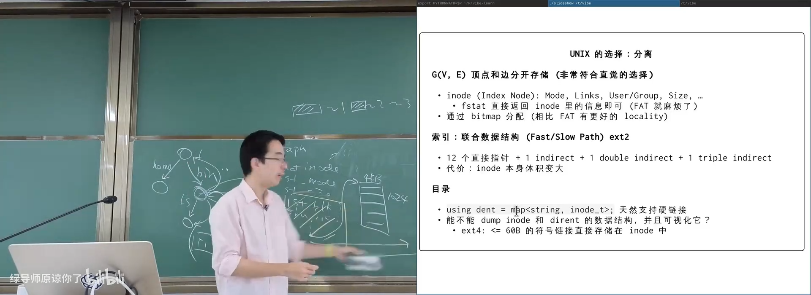

### 6.6 debugfs 可视化

*(参考时间: 00:49)*

`debugfs` 可以在用户态读取 ext4 内部结构：

- inode；
- block allocation；
- directory entry；
- 符号链接目标；
- 文件到块的映射。

```mermaid
flowchart LR
    A["ext4 Image"] --> B["debugfs"]
    B --> C["Inodes"]
    B --> D["Directory Entries"]
    B --> E["Block Maps"]
    C --> F["Visualization"]
    D --> F
    E --> F
```

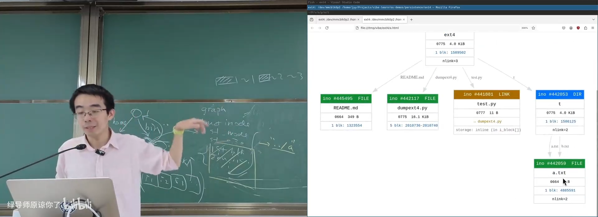

---

## 7. 崩溃一致性：块写入不是事务

### 7.1 一次 append 涉及多次写

*(参考时间: 00:51)*

追加一个数据块：

```text
1. bwrite(block bitmap)
2. bwrite(data)
3. bwrite(inode)
```

每个操作本身可能成功，但设备可以重排写顺序。

```mermaid
flowchart LR
    A["Allocate Block"] --> B["Update Bitmap"]
    B --> C["Write Data"]
    C --> D["Update Inode"]
    D --> E["Filesystem Visible"]
    F["Crash at Any Point"] --> G["Possible Inconsistent State"]
```

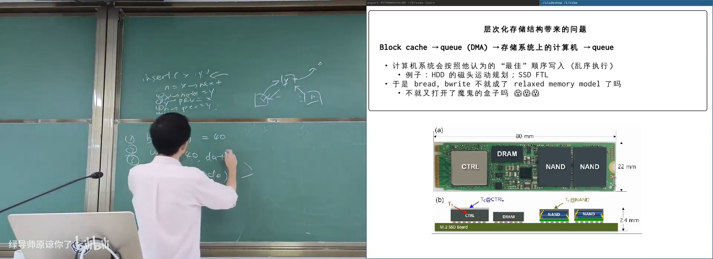

### 7.2 设备会重排写入

*(参考时间: 00:55)*

从文件系统到物理介质之间有多层队列：

```text
block cache
  → block queue
  → HDD scheduler / SSD FTL
  → flash controller
```

HDD 会优先选择距离读写头最近的请求；SSD 会把写分配到不同物理块。

```mermaid
flowchart TD
    A["bwrite 1"] --> Q["Device Queue"]
    B["bwrite 2"] --> Q
    C["bwrite 3"] --> Q
    Q --> D["Reordered Physical Writes"]
    D --> E["Crash May Persist Any Subset"]
```

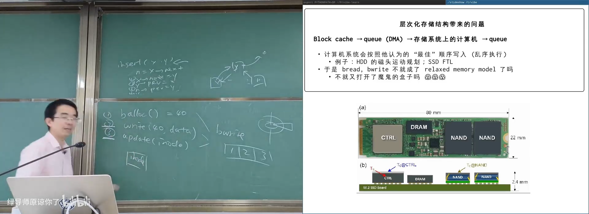

### 7.3 2³ 种结果

*(参考时间: 00:56)*

三个块写入在崩溃后可形成 `2³ = 8` 种已落盘子集。

例如：

```text
inode 已更新
data 已更新
bitmap 未更新
```

文件当前看起来正常，但未来 bitmap 会再次分配该块，导致数据被覆盖。

```mermaid
flowchart TD
    A["Inode Points to Block 40"] --> B["Block 40 Contains Hello"]
    C["Bitmap Still Marks Block 40 Free"] --> D["Future Allocation Reuses Block 40"]
    D --> E["File Data Corrupted Later"]
```

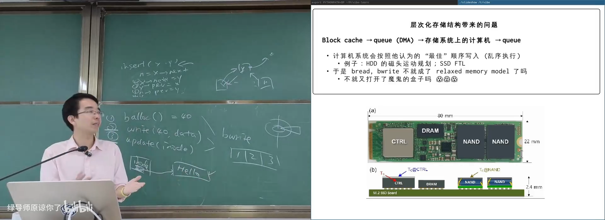

### 7.4 SSD FTL 崩溃

*(参考时间: 00:58)*

早期 SSD 在掉电时可能损坏 FTL 自身的数据结构：

- L2P 映射表损坏；
- 整个盘无法读取；
- SSD 无法像 HDD 一样拆盘恢复。

课程提到通过可编程关断电源，曾发现多类 SSD 固件崩溃问题。

```mermaid
flowchart TD
    A["Power Loss"] --> B["FTL Metadata Torn"]
    B --> C["Logical-to-Physical Map Invalid"]
    C --> D["Drive Unreadable"]
    D --> E["Firmware Failure Fixes"]
```

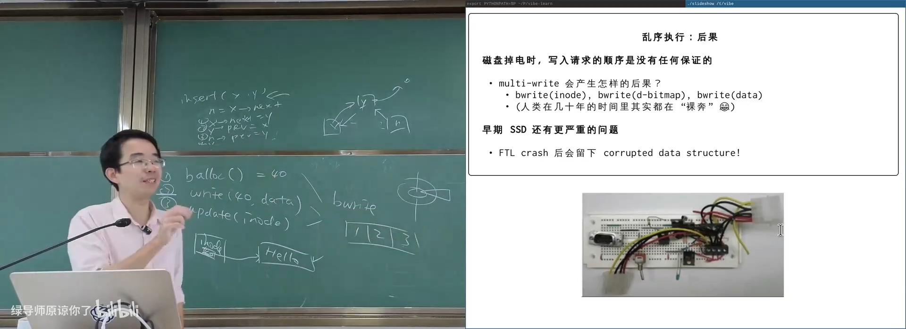

---

## 8. FSCK：事后修复数据结构

### 8.1 扫描一致性

*(参考时间: 01:00)*

File System Check 扫描：

- inode 指向的数据块；
- block bitmap；
- directory graph；
- 链接计数；
- 超级块。

可以恢复“最可能”的旧状态，但无法保证所有数据正确。

```mermaid
flowchart TD
    A["Scan Inodes"] --> D["Collect Used Blocks"]
    B["Scan Bitmap"] --> E["Compare Allocation"]
    C["Scan Directories"] --> F["Rebuild Graph"]
    D --> G["Fix Inconsistencies"]
    E --> G
    F --> G
```

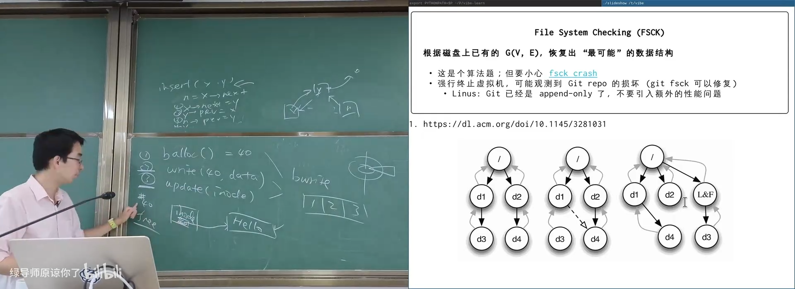

### 8.2 lost+found

*(参考时间: 01:01)*

如果 inode 仍存在，但没有任何目录指向它，FSCK 可能把它放进：

```text
/lost+found
```

```mermaid
flowchart LR
    A["Orphan Inode"] --> B{"Valid File Data？"}
    B -- "是" --> C["Move to lost+found"]
    B -- "否" --> D["Discard / Repair"]
```

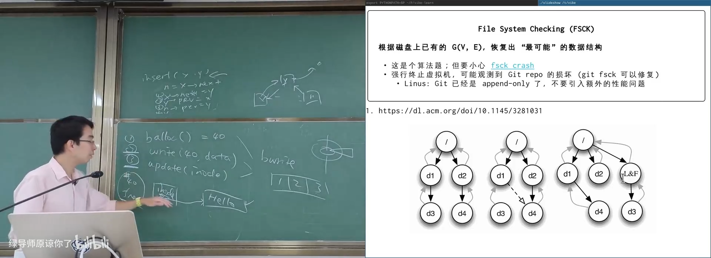

### 8.3 多指针更新天然不安全

*(参考时间: 01:02)*

链表插入：

```text
x->next = y
y->prev = x
y->next = n
n->prev = y
```

崩溃在中间会留下半插入状态。

```mermaid
flowchart TD
    A["x.next = y"] --> B["y.prev = x"]
    B --> C["y.next = n"]
    C --> D["n.prev = y"]
    E["Crash After Step 2"] --> F["Half-linked Structure"]
```

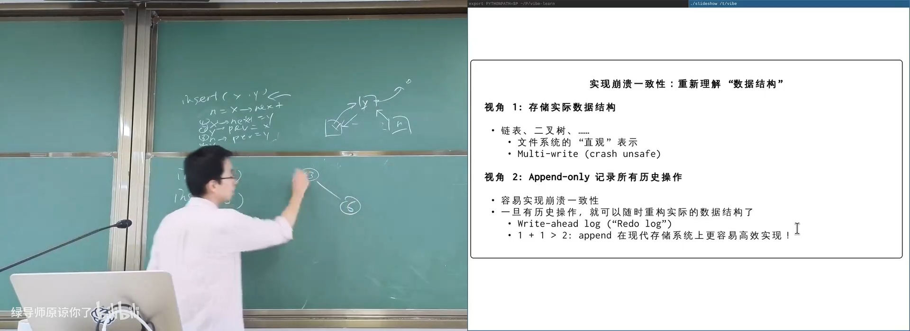

---

## 9. 实现崩溃一致性：Append-only 与日志

### 9.1 两种数据结构视角

*(参考时间: 01:03)*

**视角 1：实际数据结构**

```text
树、链表、bitmap、inode
```

直接 multi-write，崩溃不安全。

**视角 2：操作日志**

```text
append operations
replay operations
```

append-only 天然更容易实现崩溃一致性。

```mermaid
flowchart LR
    A["Actual Data Structure"] --> B["Multiple Writes"]
    B --> C["Crash Unsafe"]
    D["Append-only History"] --> E["Replay"]
    E --> F["Crash Consistent"]
```

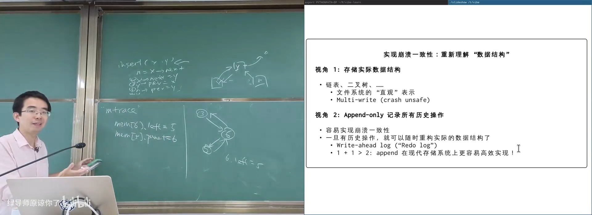

### 9.2 LSM Tree

*(参考时间: 01:06)*

Log-Structured Merge Tree：

- 内存 MemTable 负责写；
- WAL 保证崩溃恢复；
- MemTable 满后 Flush；
- 磁盘只保存 immutable SSTable；
- 定期 Merge 小树到大树。

```mermaid
flowchart TD
    A["Write Request"] --> B["MemTable"]
    A --> C["WAL"]
    B --> D{"MemTable Full？"}
    D -- "是" --> E["Flush to SSTable"]
    E --> F["Merge Lower Levels"]
    C --> G["Crash Recovery"]
```

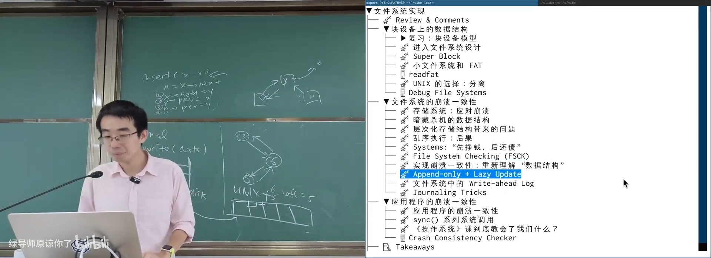

### 9.3 Write-ahead Log

*(参考时间: 01:08)*

文件系统日志：

1. 写 `TXBegin`；
2. 写实际要修改的块；
3. `flush`；
4. 写 `TXEnd`；
5. `flush`；
6. 后台 checkpoint 到真实位置；
7. 回收日志。

```mermaid
flowchart TD
    A["TXBegin"] --> B["Journal Operations"]
    B --> C["flush"]
    C --> D["TXEnd"]
    D --> E["flush"]
    E --> F["Replay / Checkpoint"]
    F --> G["Reclaim Journal"]
```


### 9.4 Checkpointing

*(参考时间: 01:10)*

如果崩溃发生在 `TXEnd` 之前：

```text
事务视为未完成
```

如果崩溃发生在 `TXEnd` 之后：

```text
事务可完整 replay
```

```mermaid
flowchart TD
    A["Crash Before TXEnd"] --> B["Ignore Transaction"]
    C["Crash After TXEnd"] --> D["Replay Transaction"]
    D --> E["Filesystem Updated"]
```


### 9.5 批处理与 JBD

*(参考时间: 01:11)*

xv6、JBD 等实现会：

- 合并多个系统调用；
- 延迟回写；
- 减少 flush 次数；
- 牺牲少量延迟和丢失窗口换性能。

```mermaid
flowchart LR
    S1["Syscall Write 1"] --> T["One Journal Transaction"]
    S2["Syscall Write 2"] --> T
    S3["Syscall Write 3"] --> T
    T --> F["Single Flush"]
```


### 9.6 ext4 checksum

*(参考时间: 01:12)*

ext4 可以：

- 不再依赖传统 `TXBegin/TXEnd` 标记；
- 在日志头记录长度和 checksum；
- 恢复时验证 checksum；
- checksum 错误则丢弃整个尾部事务。

```mermaid
flowchart TD
    A["Journal Header"] --> B["Length + Checksum"]
    B --> C["Replay / Scan"]
    C --> D{"Checksum Valid？"}
    D -- "是" --> E["Apply Transaction"]
    D -- "否" --> F["Discard Tail"]
```


### 9.7 Metadata Journaling

*(参考时间: 01:14)*

ext4 默认元数据日志：

- inode、bitmap、目录结构进日志；
- 文件数据不进日志；
- 保证目录树一致；
- crash 可能丢最近数据。

```mermaid
flowchart LR
    A["Metadata Writes"] --> J["Journal"]
    B["File Data Writes"] --> D["Direct Write Path"]
    J --> C["Directory Tree Consistency"]
    D --> E["Recent Data May Be Lost on Crash"]
```


---

## 10. 应用程序也必须实现崩溃一致性

### 10.1 常见的错误保存方式

*(参考时间: 01:15)*

看起来合理的文件保存：

```python
Path("a.txt.tmp").write_text(new_data)
unlink("a.txt")
rename("a.txt.tmp", "a.txt")
```

但元数据日志可能只重放了：

```text
create a.txt.tmp
unlink a.txt
```

而没有重放数据写入，最终用户看到文件消失。

```mermaid
sequenceDiagram
    participant App
    participant FS
    App->>FS: create temp
    App->>FS: write temp
    App->>FS: unlink original
    App->>FS: rename temp
    Note over FS: Crash before data durable
    FS-->>App: Replay metadata only
    App->>FS: File missing / empty
```


### 10.2 Git 的 crash consistency

*(参考时间: 01:17)*

Git 是 append-only object store，通常不调用同步：

- 对象一旦写入，不像普通文件那样原地修改；
- FSCK 可以恢复引用图；
- 快速关闭虚拟机可能导致 Git 目录不一致；
- `git fsck` 可以重新扫描对象。

课程 makefile 中加入全局 `sync` 以保证提交落盘。

```mermaid
flowchart TD
    A["Git Objects"] --> B["Append-only Store"]
    B --> C["Crash May Leave Partial Filesystem"]
    C --> D["git fsck"]
    D --> E["Recover Object Graph"]
```


### 10.3 sync 系列系统调用

*(参考时间: 01:19)*

```c
sync();
syncfs(fd);
fsync(fd);
fdatasync(fd);
```

区别：

| 调用 | 同步范围 |
|---|---|
| `sync` | 所有文件系统 |
| `syncfs` | 一个文件系统 |
| `fsync` | 文件数据 + 全部元数据 |
| `fdatasync` | 文件数据 + 影响读回的必要元数据 |

```mermaid
flowchart LR
    A["sync()"] --> B["Global"]
    C["syncfs(fd)"] --> D["Filesystem"]
    E["fsync(fd)"] --> F["File + Metadata"]
    G["fdatasync(fd)"] --> H["File Data + Minimal Metadata"]
```


### 10.4 fdatasync 与数据库

*(参考时间: 01:21)*

固定大小的数据库文件：

- 空间早已分配；
- 修改数据不改文件大小；
- inode block map 不变；
- `fdatasync` 不需要同步大多数 inode 变化。

因此数据库 WAL 常优先使用 `fdatasync`。

```mermaid
flowchart TD
    A["Fixed-size Database File"] --> B["Data Written"]
    B --> C["Size Unchanged"]
    B --> D["Block Map Unchanged"]
    C --> E["fdatasync"]
    D --> E
    E --> F["Avoid Inode Write"]
```


### 10.5 正确保存文件

*(参考时间: 01:22)*

基本模式：

```python
write("a.txt.tmp", new_data)
fsync(fd_of_tmp)
rename("a.txt.tmp", "a.txt")
```

关键要求：

- 新数据先 `fsync`；
- rename 由文件系统提供原子性；
- 必要时再同步目录项。

```mermaid
flowchart LR
    A["Write Temp File"] --> B["fsync Temp"]
    B --> C["Atomic rename"]
    C --> D["Old or New Complete Version"]
```


### 10.6 现实软件中的问题

*(参考时间: 01:23)*

课程研究曾发现：

- Make 可能留下错误构建结果；
- in-place sort 可能损坏文件；
- Perl 的 in-place 替换可能丢文件；
- 2016 年的 Node.js 缺少安全保存文件的标准 API；
- 许多 Electron 应用存在同类问题。

```mermaid
flowchart TD
    A["Legacy Application"] --> B["Temporary File"]
    B --> C["Delete Original"]
    C --> D["Rename"]
    D --> E["Crash Inconsistency"]
    F["Missing fsync"] --> E
```


---

## 11. Crash Consistency Checker

*(参考时间: 01:25)*

课程用 `strace` 追踪程序对文件的写入和同步调用：

1. 记录文件相关系统调用；
2. 枚举多种 crash 点；
3. 构造可能的重排顺序；
4. 重放文件系统状态；
5. 用 LLM 判断是否存在数据丢失或不一致；
6. 输出 `result.json`。

```mermaid
flowchart TD
    A["Application Run"] --> B["strace File Syscalls"]
    B --> C["Trace + fsync Points"]
    C --> D["Generate Crash Prefixes"]
    D --> E["Replay States"]
    E --> F["LLM Inspect Result"]
    F --> G["Inconsistency Report"]
```


### 11.1 AI 时代的研究机会

*(参考时间: 01:26)*

讲师指出：

- 老论文的思想可以用 AI 重新实现；
- 实验规模可以扩大百倍；
- LLM 可以替代许多脆弱 heuristics；
- 但不要只做“洗论文”；
- 应利用工具探索世界上没人做过的问题。

```mermaid
flowchart LR
    A["Old Conceptual Paper"] --> B["LLM Reimplementation"]
    B --> C["Larger Experiment"]
    C --> D["New Evidence"]
    D --> E["Original Research"]
    C --> F["Paper Washing"]
```


---

## 12. 总结：用合适的数据结构守护持久数据

文件系统实现包含多个层次：

1. 用 GPT、LVM、NVMe Namespace 等虚拟化块设备；
2. 用 Superblock 建立入口；
3. 用 FAT 或 inode 组织文件块；
4. 用目录项组织命名图；
5. 用缓存降低块访问成本；
6. 用 FSCK 修复非一致状态；
7. 用 WAL/Journal 保证多块更新原子性；
8. 用 `fsync`、`fdatasync` 和原子 rename 保证应用级持久性。

```mermaid
flowchart TD
    A["Block Device"] --> B["Partitions / LVM"]
    B --> C["Superblock"]
    C --> D["Allocation Metadata"]
    C --> E["Inodes"]
    C --> F["Data Blocks"]
    E --> G["Directory Graph"]
    G --> H["Filesystem Operations"]
    H --> I["Journal / WAL"]
    I --> J["Crash Consistency"]
```

核心结论：

> 文件系统不是必须照搬教科书的固定结构，而是围绕硬件、workload 和一致性要求设计的数据结构。持久数据的安全来自底层日志、同步协议和应用程序保存协议的共同配合。

---

## 附：官方参考与延伸阅读

- [UEFI GPT 规范](https://uefi.org/specs/UEFI/2.10/05_GUID_Partition_Table_Format.html)
- [LVM 实验](https://jyywiki.cn/OS/demos/persistence/lvm)
- [MS FAT 规范](https://jyywiki.cn/OS/manuals/MSFAT-spec.pdf)
- [readfat 实验](https://jyywiki.cn/OS/demos/persistence/readfat)
- [Debug ext4 实验](https://jyywiki.cn/OS/demos/persistence/ext4)
- [FSCK Crash 论文](https://dl.acm.org/doi/10.1145/3281031)
- [Crash Consistency Checker](https://jyywiki.cn/OS/demos/persistence/ccheck)
- [All File Systems Are Not Created Equal](https://www.usenix.org/conference/osdi14/technical-sessions/presentation/pillai)
- [Crash Consistency: Rethinking Application Programming Models](https://dl.acm.org/doi/10.1145/2950290.2950327)

官方课程资料：

- [课程主页](https://jyywiki.cn/OS/2026/)
- [第 26 讲讲义：文件系统实现](https://jyywiki.cn/OS/2026/lect26.md)
- [视频：26 - 文件系统实现和崩溃一致性](https://www.bilibili.com/video/BV12EV66bErd/)

> **版权与署名**：本讲课程材料由蒋炎岩（jyy）编写。课程讲义与幻灯片采用 [Creative Commons BY-NC 4.0](http://creativecommons.org/licenses/by-nc/4.0/) 许可；本电子书保留课程出处、作者署名与许可说明。
