# 数据库系统：从文件持久化到 ACID 与向量检索

> **课程**：2026 春季学期《操作系统原理》  
> **讲师**：蒋炎岩（jyy）  
> **官方课程主页**：<https://jyywiki.cn/OS/2026/>  
> **官方讲义**：<https://jyywiki.cn/OS/2026/lect27.md>  
> **视频来源**：[Bilibili BV1eqEA6JEZA](https://www.bilibili.com/video/BV1eqEA6JEZA/)  
> **版权说明**：课程讲义与幻灯片归蒋炎岩所有，采用 [Creative Commons BY-NC 4.0](http://creativecommons.org/licenses/by-nc/4.0/) 许可；本电子书是对课堂讲授的书面化重构，保留出处与许可说明。

## 导语：应用程序的数据最终都是数据结构

*(参考时间: 00:00)*

上一讲把文件系统理解为“磁盘上的一个数据结构”：UNIX 文件系统要保存一棵目录树或目录图，并且必须在块设备上实现它。除了树和图本身，持久化系统还要解决两个额外问题：

- 文件系统的 crash consistency；
- 应用程序自己的 crash consistency。

系统可能在任何时刻断电。重启后，最近的少量操作可以丢失，但整个数据结构不能损坏，并且必须能够恢复到一个合法状态。

这一讲顺着文件系统继续向后走。既然文件系统可以持久保存数据，那么应用程序应该怎样保存自己的数据？从小型课程网站到教务系统，再到服务全国乃至全球用户的数据库，持久数据的方法会如何演化？


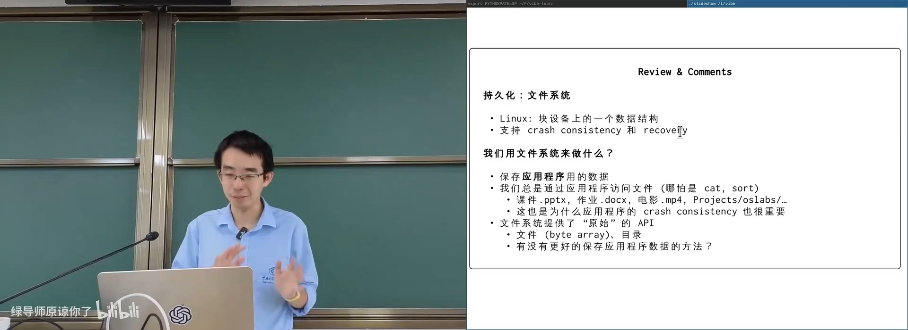

---

## 1. 持久保存应用数据

### 1.1 应用程序是物理世界过程的投影

*(参考时间: 03:00)*

讲师用一句话概括软件：

> 软件是物理世界过程在信息世界中的投影。

这个投影通常是有损的。现实世界包含人的情绪、上下文以及无法完整记录的信息，而软件只能保存其中有限的一部分。即便如此，软件仍然天生具有持久保存数据的需求：

- 个人信息和学籍；
- 订单与支付记录；
- 日志、维护记录和业务状态；
- 课程、成绩、聊天与用户行为。

这些数据的共同本质，是对某个数据结构进行创建、读取、更新和删除，也就是 CRUD。文件、数据库、配置、聊天记录，看起来是完全不同的产品，背后都是数据结构的维护问题。

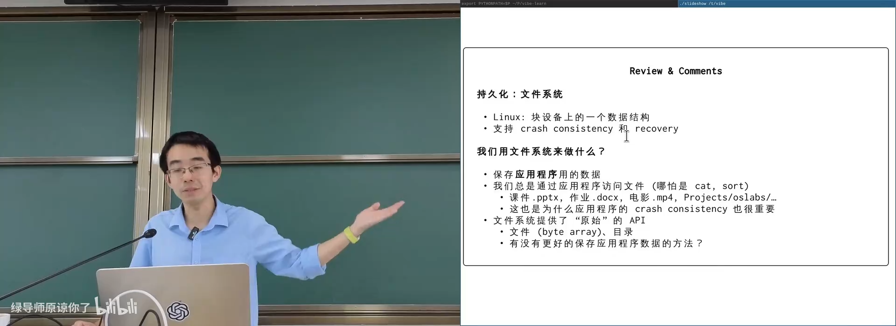

一个典型例子是学校的教务系统。教师、管理员和学生看到不同界面，也拥有不同的权限：

- 教师可以查看教学班、周历和考核信息；
- 学生可以查看自己的选课列表；
- 不同角色只能修改允许修改的字段。

讲师在演示中打开了操作系统课程的教学班。授课类型等字段可以编辑，而考核方式等危险字段会禁止修改。页面上的每一次配置，最终都对应后台数据结构中的一次更新。

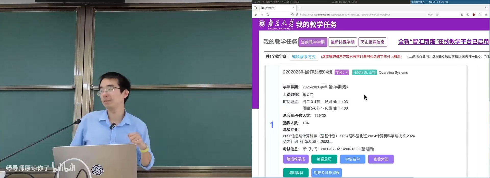

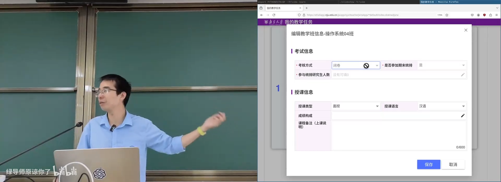

### 1.2 连 PPTX 也是一个数据结构

*(参考时间: 06:00)*

人们通常不把演示文稿当成数据库，但 PPTX 本质上就是一棵树形数据结构。它遵循 Office Open XML 标准，真实格式是一个 ZIP 容器，内部包含 XML、媒体文件和布局描述。

可以直接执行：

```bash
file lecture.pptx
unzip lecture.pptx -d lecture_unpacked
find lecture_unpacked/ppt/media -type f
```

解包后可以看到：

- 每一页幻灯片对应的 XML；
- 幻灯片母版和版式；
- 图片、字体和其他媒体资源；
- 页面上每个对象的位置和样式。

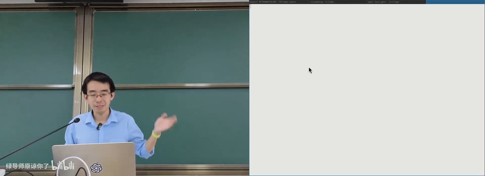

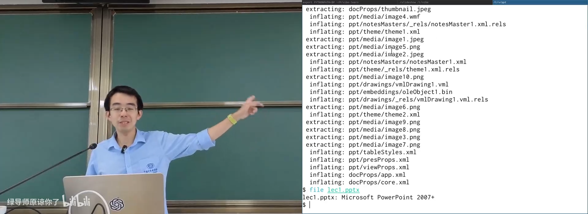

这也意味着，PPTX 可以被程序直接修改。课堂演示中，讲师打开一个 Coding Agent，让它批量修改演示文稿中的文本。页面标题和正文被替换为英文，其他结构保持不变。

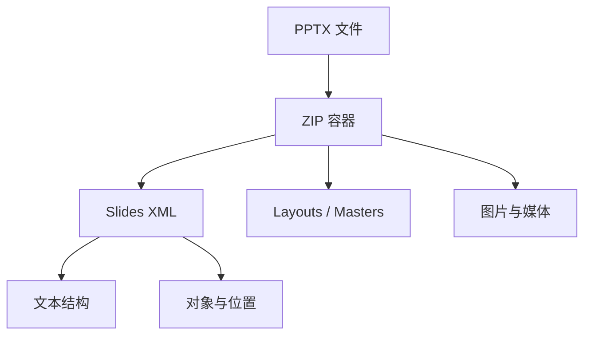

这种修改方式简单直接，但也暴露出问题：XML 不一定规整，对复杂文档直接做文本替换并不可靠。更稳妥的做法是使用 Office 自动化接口或具有结构化语义的 API。课堂的判断不是“所有 XML 都必须手工改”，而是：只要一个产品能够被还原为数据结构，它就可以被查询、分析和自动化编辑。

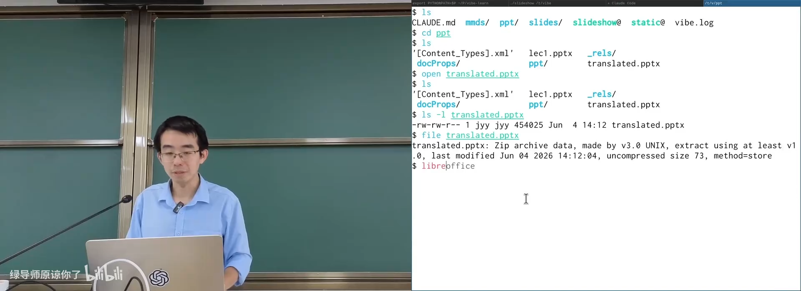

### 1.3 方法一：Everything is a File

*(参考时间: 09:30)*

如果要在 UNIX 上实现一个教务系统，最直接的方法是使用目录和文件：

```text
ehall.nju.edu.cn/teacherJxrwApp/22020230/4
├── enrollment
│   ├── 231220001.md
│   ├── 231220002.md
│   └── ...
├── metadata.json
├── syllabus
│   ├── 1-intro.md
│   └── ...
└── textbook
    └── 1-ostep.md
```

每个学生、课程或选课记录都可以对应一个目录或文件。符号链接还能表达“引用”关系。例如，选课目录中的学生链接可以指向学生主目录：

```text
enrollment/231220001 -> ../../students/231220001
```

学生更新邮箱或手机号后，通过链接读取到的新信息会自动同步，不需要复制第二份。

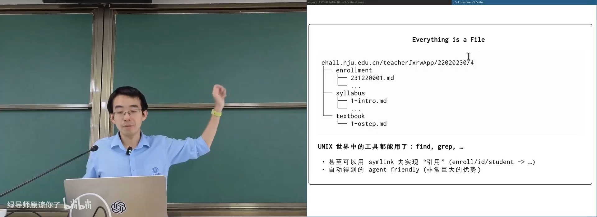

这种方法具有明显优势：

- `find`、`grep`、`sort`、`xargs` 等 UNIX 工具直接可用；
- 文件格式透明，人和程序都容易检查；
- Coding Agent 天然熟悉文件系统；
- 可以利用符号链接、权限、原子 rename 等既有机制。

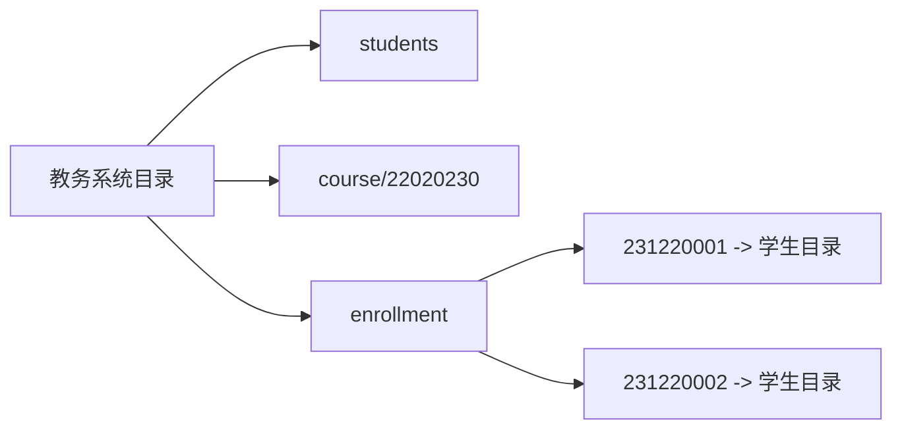

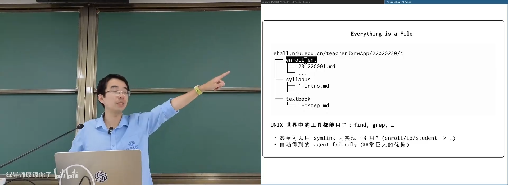

### 1.4 课程网站与 Online Judge

*(参考时间: 13:50)*

课程网站是文件系统方案的典型应用。所有学生提交都存放在固定目录中：

```text
/var/www/filerecv/OS2026/M1/[stuid]/
  2026-04-04-19-26-43.tar.bz2
  2026-04-04-19-26-43.tar.bz2.result
```

提交程序只负责把压缩包放入目录。另一个监听程序不断扫描：

- 存在提交包，但不存在对应 `.result`；
- 说明该提交尚未评测；
- 将压缩包送入 Online Judge；
- 评测完成后，把结果写回同名 `.result` 文件。

统计提交结果可以直接使用 Shell：

```bash
cat M5/*.result | grep 'Accepted' | wc -l
```

重新评测也十分简单：

```bash
echo M5/**/*.result | xargs rm
```

监听程序发现缺少结果，就会重新把它送入评测队列。

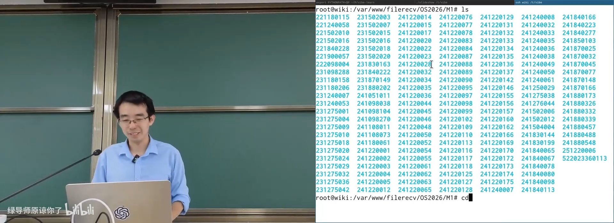


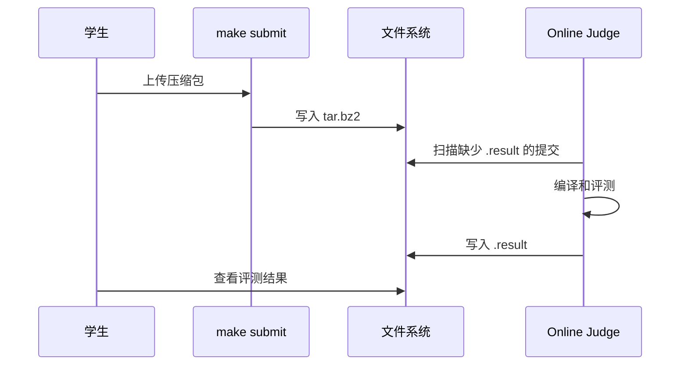

### 1.5 文件方案的代价

*(参考时间: 17:20)*

文件系统很好用，但它不是免费的：

1. **多文件写入没有全局原子性。** 批量导入 100 个学生的选课信息时，如果写到第 50 个文件系统崩溃，数据就处于半完成状态。
2. **需要自行实现 recovery。** 应用必须像 Git 一样采用 append-only 结构，或者自己执行类似 FSCK 的一致性修复。
3. **存在读写放大和额外元数据开销。** 路径解析、权限检查、inode 更新、访问时间和修改时间等，可能都是应用并不需要维护的信息。

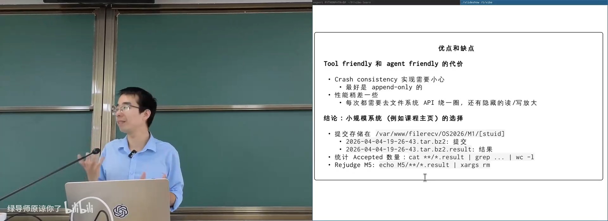

这不是说文件方案不可靠，而是它的可靠性边界在应用层。课程网站可以使用这种方案，因为：

- 云 SSD 和虚拟机通常相当可靠；
- 即使偶发丢失一个 `.result`，学生重新提交即可；
- 小规模系统的开发效率远比极致的存储效率重要。

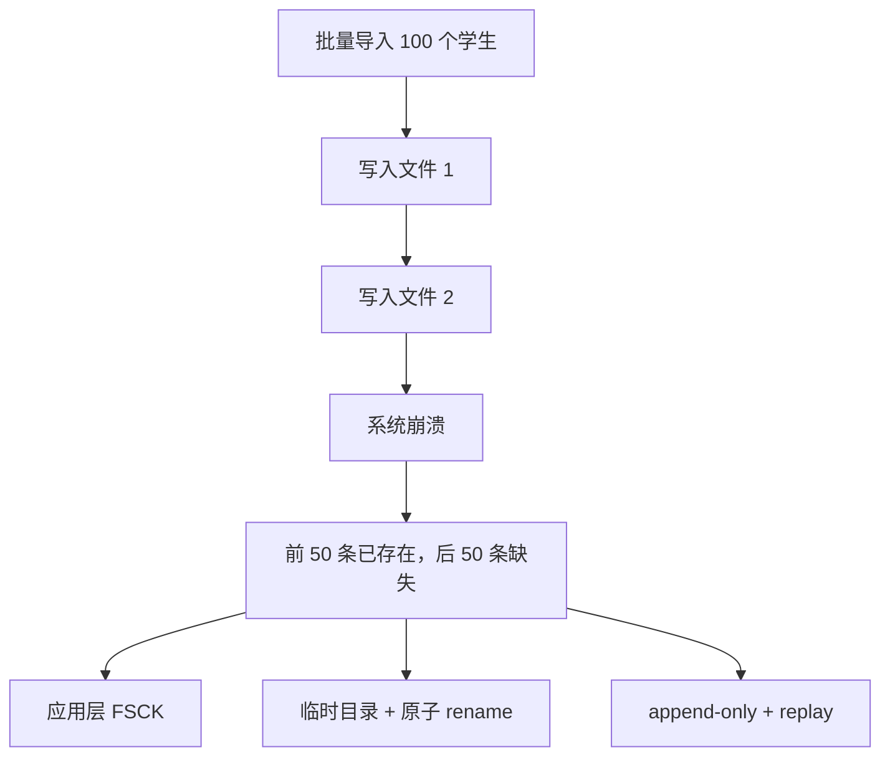

### 1.6 方法二：直接在文件上构建数据结构

*(参考时间: 19:40)*

既然磁盘是一个字节数组，文件也是一个字节数组，那么我们可以把文件当成虚拟磁盘，在其上重新实现数据结构。

一个微型的教务数据库可以在文件头部放一个 Superblock：

```c
struct superblock {
    struct student *students;
    struct course *courses;
    struct enrollment *enrollments;
    size_t count;
};

struct student {
    char stuid[16];
    char name[32];
    struct student *next;
};

struct course {
    char cid[16];
    char title[64];
    struct course *next;
};
```

实现 CRUD 的方式，与数据结构课中的链表、哈希表和树没有本质区别：

```c
void enroll(struct student *s, struct course *c) {
    struct enrollment *e = allocate();
    e->student = s;
    e->course = c;
    e->next = database->enrollments;
    database->enrollments = e;
}
```

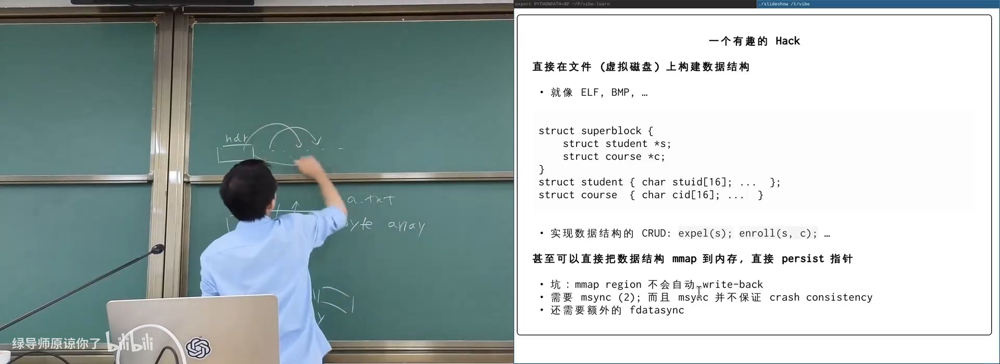

### 1.7 mmap：把持久文件映射成内存指针

*(参考时间: 22:00)*

如果每次都把数据库文件映射到同一个虚拟地址，那么内存中的绝对指针就可以被持久化。下次打开数据库时，所有指针仍然指向相同地址。

```c
void *base = mmap(
    FIXED_ADDRESS,
    file_size,
    PROT_READ | PROT_WRITE,
    MAP_SHARED,
    fd,
    0
);

struct superblock *db = base;
```

课堂中的演示程序直接创建了学生链表。退出并重新打开后，学生记录依然存在；查看二进制文件时，甚至可以看见学生姓名。

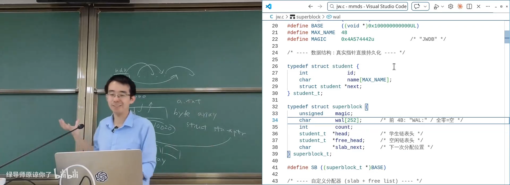

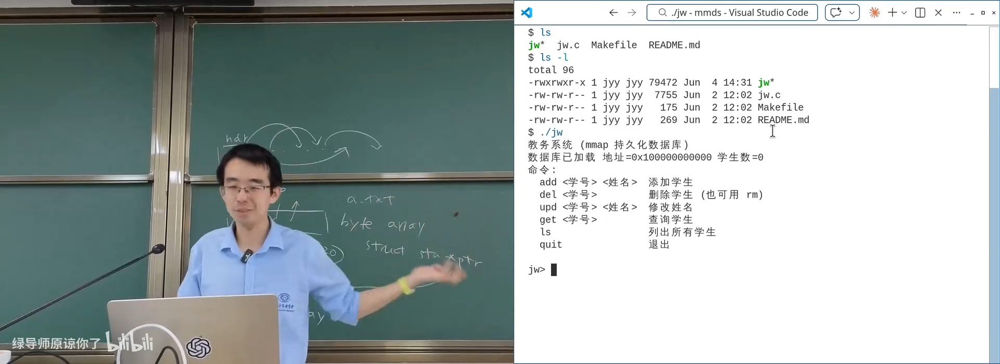

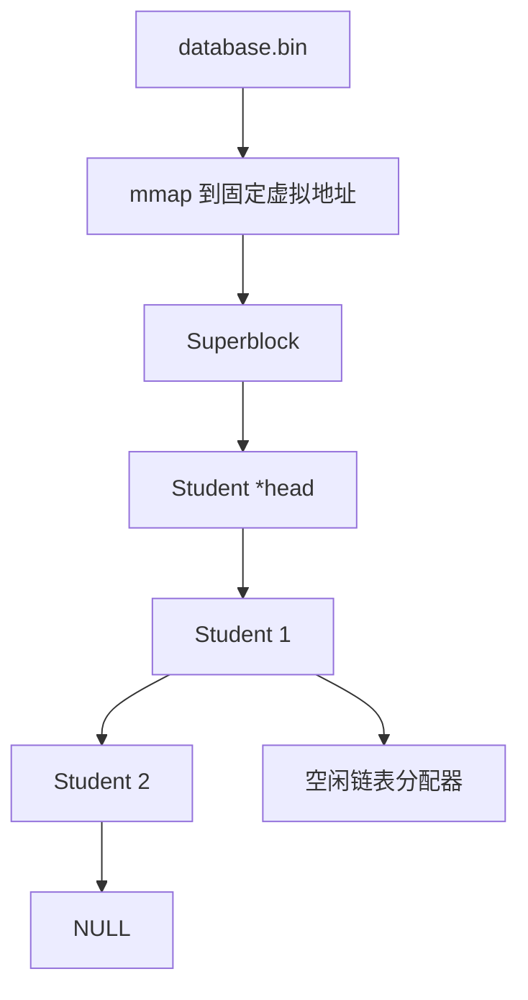

### 1.8 mmap 并不等于 crash consistency

*(参考时间: 26:30)*

mmap 隐藏了很多复杂度。内存页不会在每次写入后立刻回到磁盘，CPU 缓存中的数据也不会自动变成持久数据：

- 映射区写入默认不一定立即 write-back；
- `msync` 只请求同步映射区，不等价于具备持久化保证的 `fdatasync`；
- `madvise` 用来提示访问模式，不是通用 POSIX 标准，性能和语义都更复杂。

```c
msync(addr, len, MS_SYNC);
fdatasync(fd);
```

`msync` 解决的是内存映射与文件之间的同步问题，`fdatasync` 继续负责把相关数据推到持久存储。要获得可恢复的事务语义，还需要额外的 WAL。

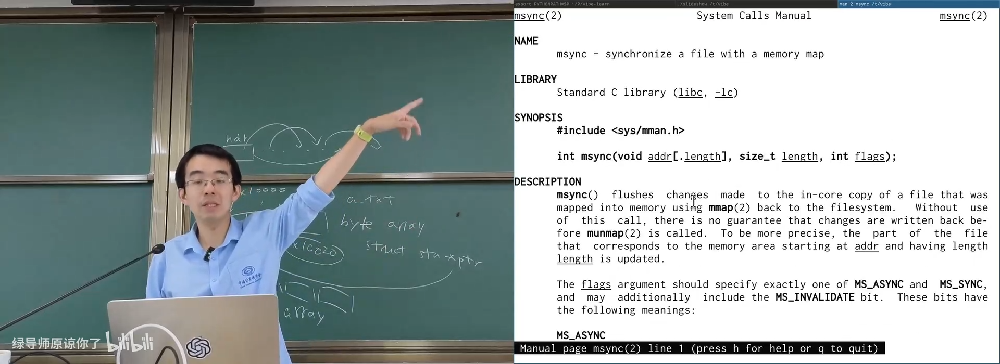

### 1.9 在 Superblock 中加入 Write-Ahead Log

*(参考时间: 29:30)*

课堂中的微型数据库偷懒但有效：在 Superblock 中放置一个很小的 WAL 区域。

```c
struct superblock {
    uint32_t magic;          // 例如 "jyDB"
    char wal[256];          // "add 99 XX"
    struct student *head;
    /* ... */
};
```

每次执行操作时，遵循以下顺序：

1. 把操作记录写入 WAL；
2. `msync`，再用 `fdatasync` 确保日志真正落盘；
3. 执行内存数据结构更新；
4. 确认更新落盘；
5. 清空 WAL。

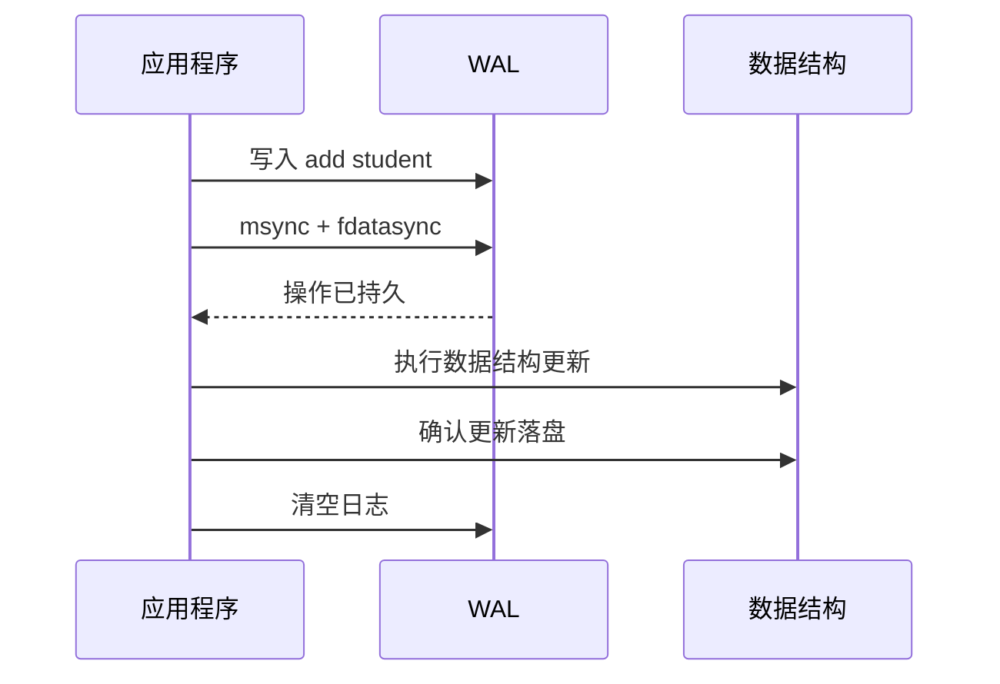

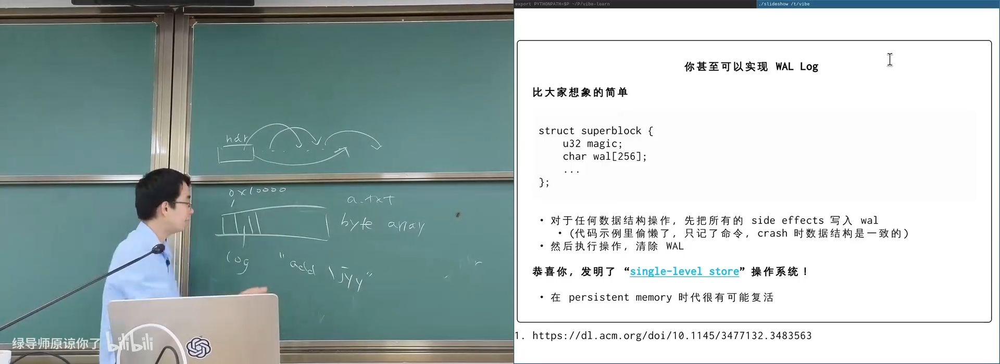

如果系统在更新数据结构后、清空 WAL 前崩溃，重启时直接重放日志；如果日志已经清空，说明事务完成。课堂演示中，讲师直接修改了 WAL 内容：

```text
add 99 XX
```

重新打开数据库后，恢复代码重放命令，99 号学生出现，WAL 随后被清空。

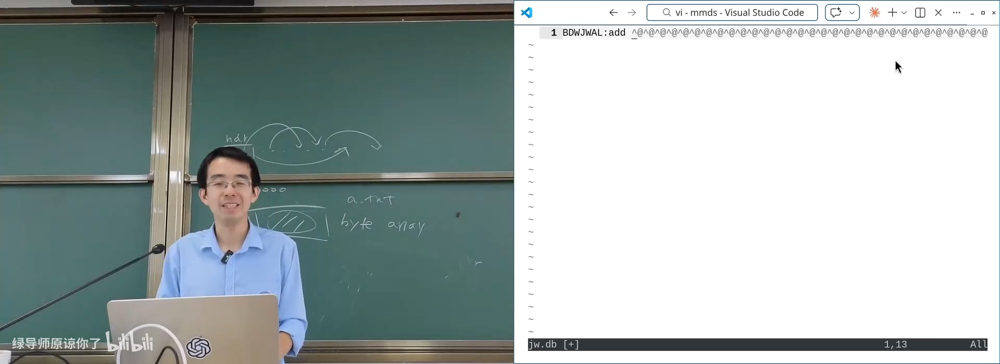

### 1.10 Single-Level Store

*(参考时间: 33:20)*

如果把整个程序的地址空间都映射到持久内存，那么进程退出和系统崩溃后，运行状态本身也不会消失。这会得到一种 Single-Level Store 操作系统：

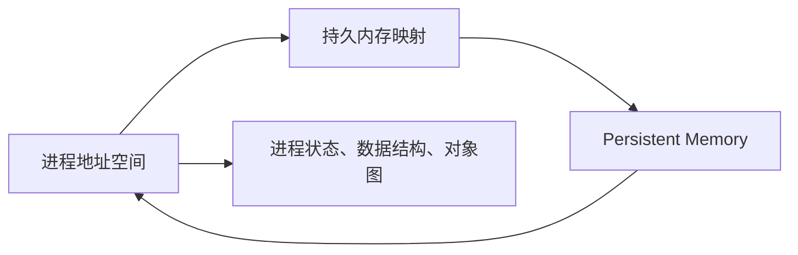

在传统系统中，内存是易失的，进程状态在断电后消失；当持久内存足够成熟时，可以把“内存”和“磁盘”统一成一层持久对象空间。课堂提到的研究问题，就是如何让整个系统的状态自然持久化。

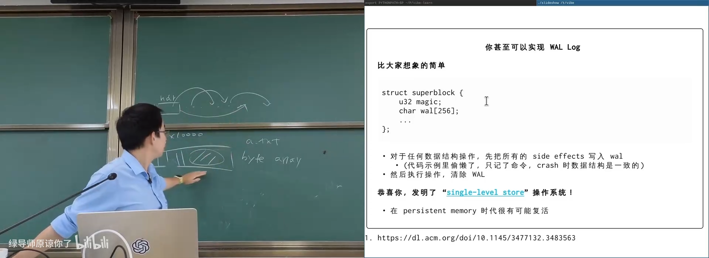

---

## 2. 关系型数据库

### 2.1 我们需要一个“非常非常好的数据结构”

*(参考时间: 35:20)*

数据库的目标比微型教务系统大得多。一个理想的数据结构需要同时满足：

- **好用**：能表达几乎任意业务数据，普通人也能理解和操作；
- **高性能**：全校同时选课、全球用户同时聊天也不能崩溃；
- **持久化**：系统随时崩溃，磁盘不坏，数据仍然正确；
- **支持 multi-write**：一次业务操作涉及多个更新时做到 all-or-nothing。

例如批量导入成绩，不能出现一半学生看见成绩、另一半学生看不到；批量导入选课名单，也不能留下半套记录。

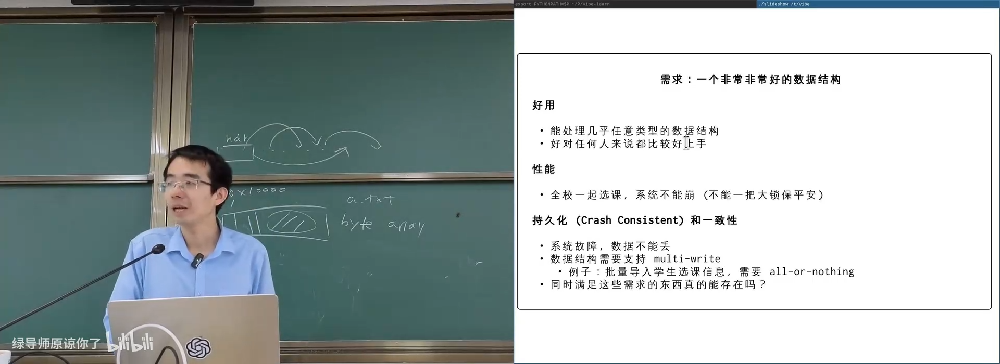

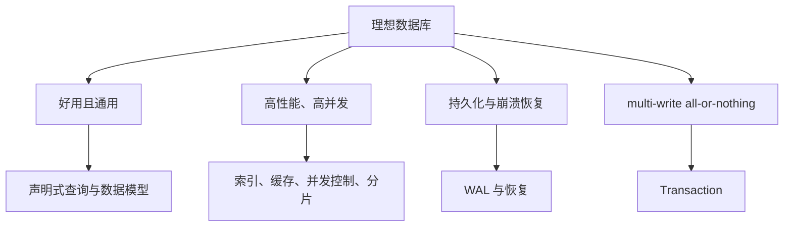

### 2.2 Pointer Machine 与关系模型

*(参考时间: 38:20)*

计算机通常被视为 Pointer Machine。内存中的数据结构依赖对象之间的指针：

```c
struct node {
    char value[32];
    struct node *left;
    struct node *right;
};
```

学生、课程和选课关系也可以用指针表示：

```c
struct enrollment {
    struct student *student;
    struct course *course;
};
```

但指针不适合作为跨应用、跨语言、跨机器的公共数据模型。数据库中常见的替代方案是二维表。

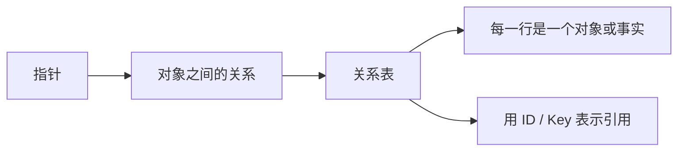

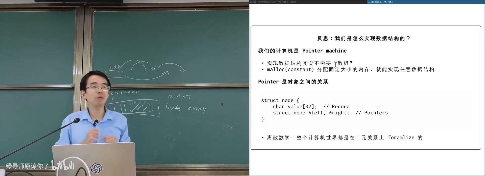

### 2.3 Everything is a table

*(参考时间: 40:20)*

关系模型把世界描述成若干事实表。选课系统只需要三类最小事实：

```text
Student(stuid, name, ...)
Course(classid, title, ...)
Takes_Course(stuid, classid, grade, ...)
```

例如：

| stuid | name |
|---|---|
| 1 | 张三 |
| 2 | 李四 |
| 3 | 王五 |

| classid | title |
|---|---|
| 4 | 操作系统 |
| 5 | 编译原理 |
| 6 | 数据库系统 |

| stuid | classid | grade |
|---|---|---|
| 3 | 4 | 未录入 |
| 3 | 5 | 未录入 |
| 6 | 1 | 未录入 |

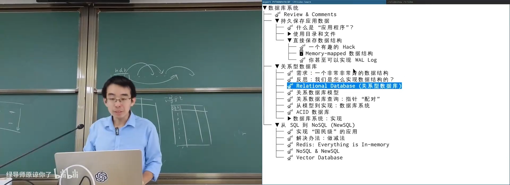

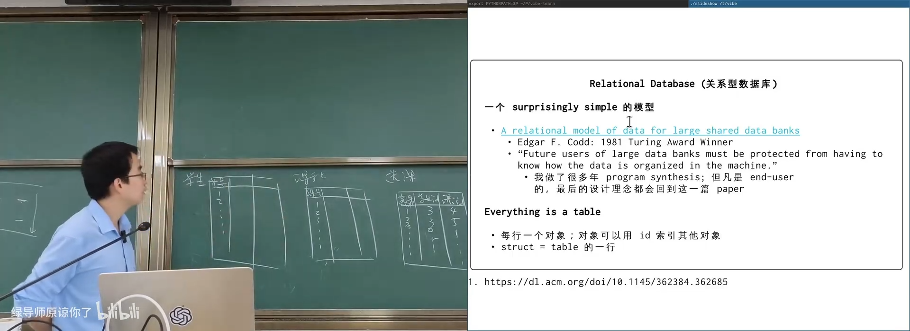

这是一种“对象和指针”的另一种表达：

- 表中的一行是对象；
- 主键唯一标识对象；
- 外键表示对象之间的关系；
- 多对多关系被显式拆成中间表。

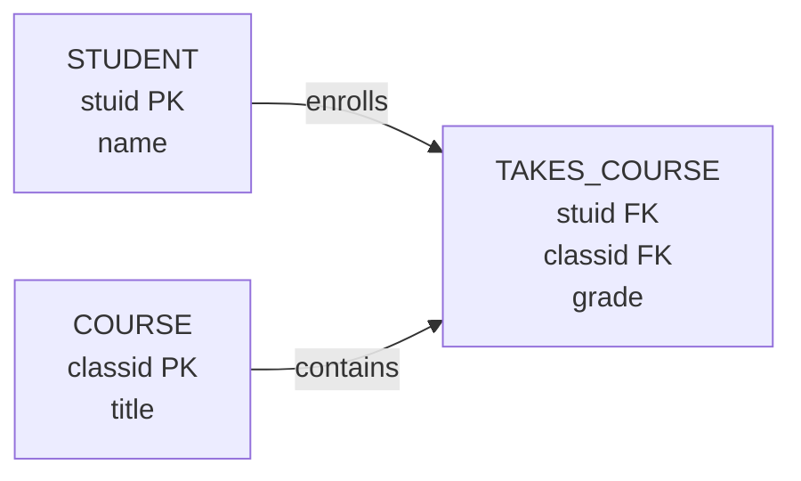

### 2.4 Join：把事实组合成查询结果

*(参考时间: 42:50)*

假如要查“选修操作系统这门课的学生”，最朴素的理解方式是：

```text
for each student s:
    for each course c:
        for each enrollment e:
            if e.stuid == s.stuid and e.classid == c.classid:
                output (s, c, e)
```

这就是笛卡尔积后的筛选，也就是 Join 的直观定义。绝大多数组合会被条件过滤掉，因为 `stuid` 和 `classid` 都是唯一键。

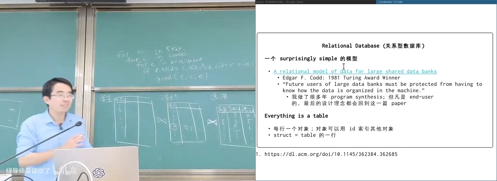

SQL 把这种关系运算写成声明式查询：

```sql
SELECT Courses.Title
FROM Student
JOIN Takes_Course
  ON Student.ID = Takes_Course.ID
JOIN Courses
  ON Takes_Course.ClassID = Courses.ClassID
WHERE Student.Name LIKE '张%';
```

数据库不要求用户写三层循环。用户只说“我想要什么”，执行引擎负责决定怎么高效地得到结果：

- 用主键或索引定位学生；
- 用外键定位选课记录；
- 用课程主键定位课程；
- 过滤姓名前缀；
- 组合最终元组。

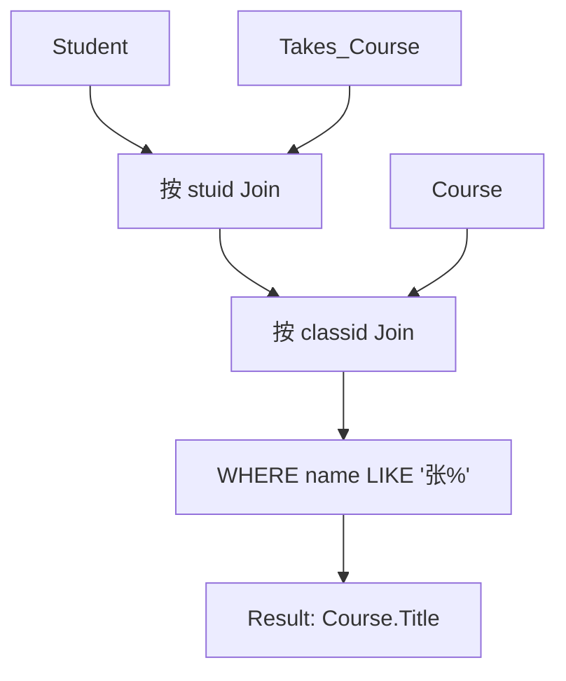

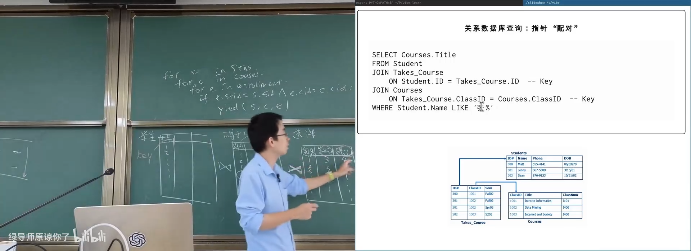

### 2.5 ACID 与 Transaction

*(参考时间: 48:40)*

关系数据库用 ACID 描述它提供的能力：

- **Atomicity**：事务中的操作要么全部生效，要么全部不生效；
- **Consistency**：事务执行前后，数据库满足约束；
- **Isolation**：并发事务彼此隔离；
- **Durability**：事务提交后的修改不会因系统崩溃而丢失。

从操作系统课程的角度，可以抓住两个更强的性质：

- **Serializability**：无论多少事务并发读写，最终效果都等价于某种串行执行；
- **Strong crash consistency**：系统崩溃也不会损坏数据结构或丢掉已经提交的操作。

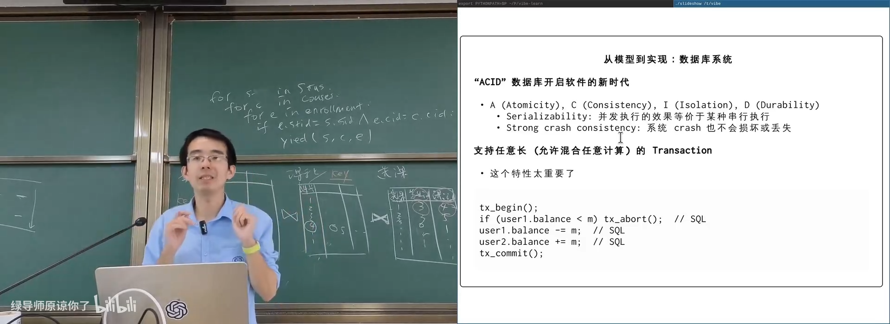

最典型的例子是转账：

```c
tx_begin();

if (user1.balance < amount) {
    tx_abort();
}

user1.balance -= amount;
user2.balance += amount;

if (some_business_condition_is_invalid) {
    tx_abort();
}

tx_commit();
```

事务中可以执行任意图灵完备的计算，甚至可以 `sleep`，可以检查复杂业务条件。只要没有提交，前面的修改都可以撤销；一旦提交，所有修改一起生效。

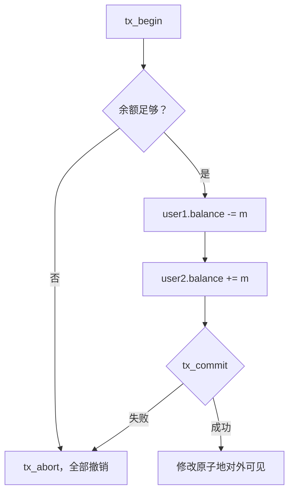

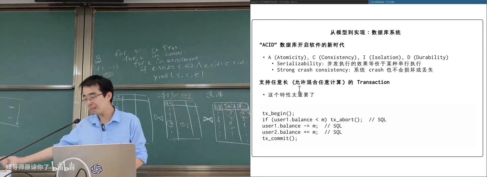

### 2.6 “一把大锁”为什么仍然快

*(参考时间: 51:50)*

从使用者的角度看，事务就像一个巨大的锁：

```text
tx_begin()
  ...
tx_commit()
```

程序员不需要在每个字段、每张表、每个对象上手工加锁。数据库在后台实现细粒度并发：

- 不同事务可以并行读写不冲突的数据；
- 同一组数据上的冲突由并发控制发现和解决；
- 日志保证崩溃恢复；
- 缓存、索引、分库分表降低访问成本。

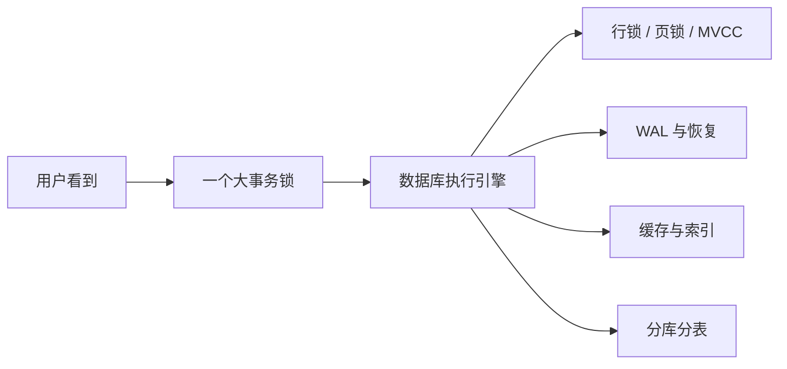

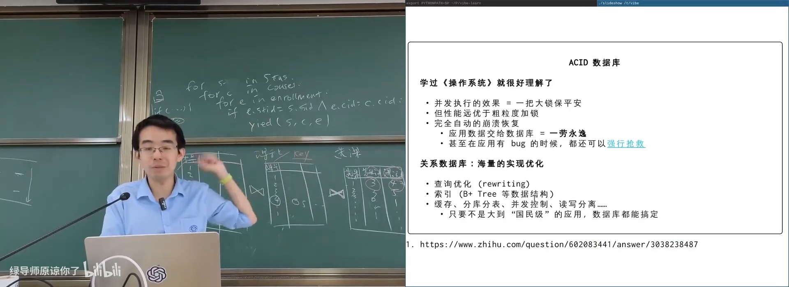

### 2.7 数据库不是“存数据”，而是实现一个系统

*(参考时间: 53:40)*

数据库系统内部的实现包含很多操作系统与编译器问题：

- 查询重写；
- 执行计划选择；
- B+ Tree 等索引；
- Buffer Pool 和缓存替换；
- 并发控制；
- WAL 与恢复；
- 分区、复制、分库分表。

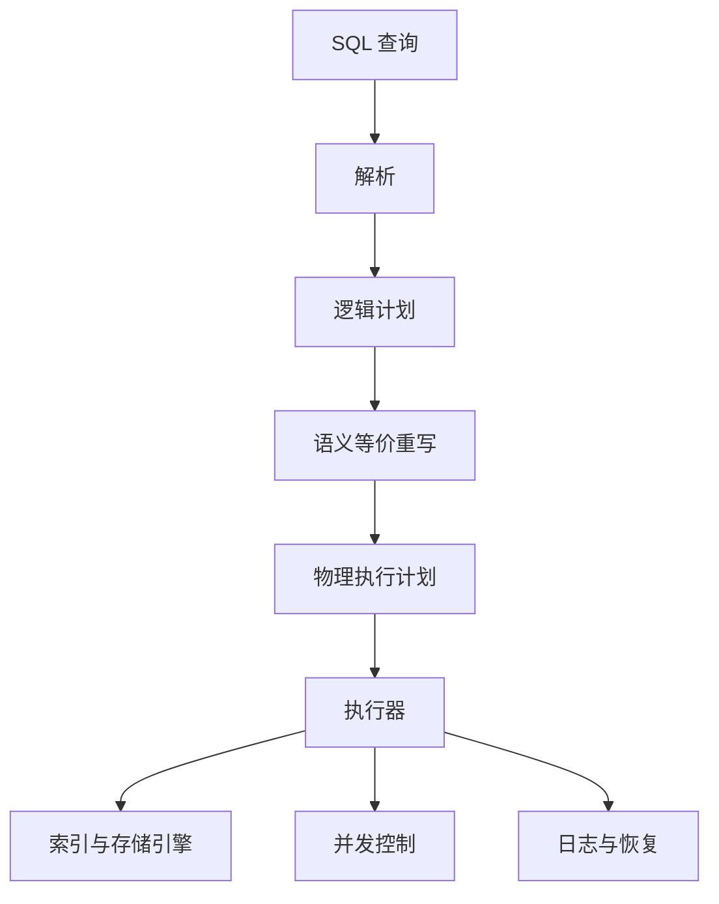

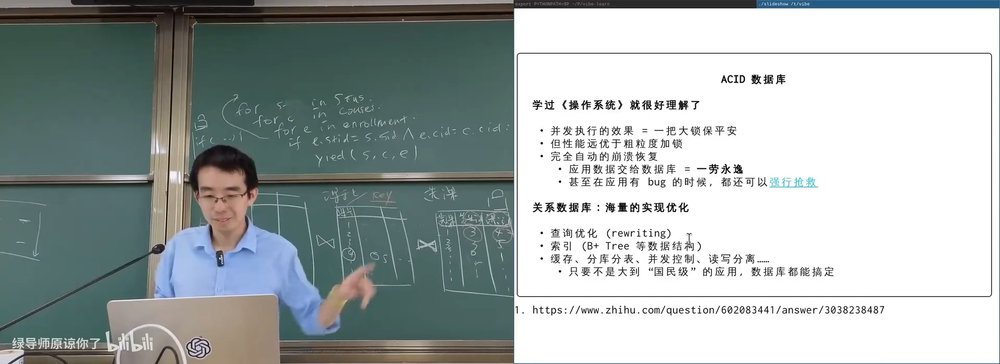

查询优化尤其像编译器。编译器把高级语言反复重写为更高效的机器代码；数据库把关系代数表达式重写为更高效的执行计划。例如，把过滤条件下推，可以大幅减少参与 Join 的数据量。

### 2.8 并发控制的难点：2PL 与 MVCC

*(参考时间: 56:20)*

事务可以并发读、写数据库的不同部分，但可能会出现冲突：

```text
T1: tx_begin(); x = 1; may_crash(); y = 2; tx_commit();
T2: tx_begin(); y = 1; sleep(long); x = 2; tx_commit();
```

T1 先写 X 再写 Y，T2 先写 Y 再写 X。两个事务可能形成 ABBA 死锁。

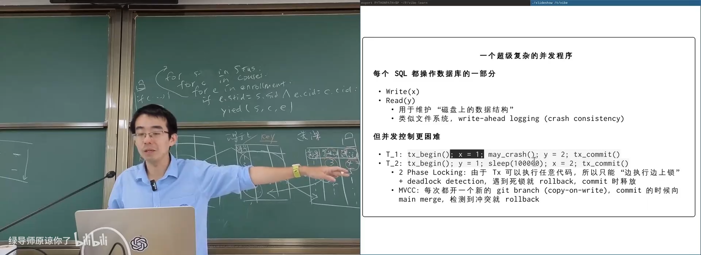

第一种方案是 Two-Phase Locking（2PL）：

- 读数据时加读锁；
- 写数据时加写锁；
- 边执行边加锁；
- 发现锁等待环后选择一个事务回滚；
- 被回滚的事务重新执行；
- 事务提交时释放锁。

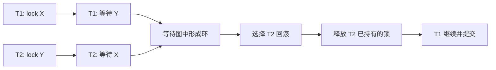

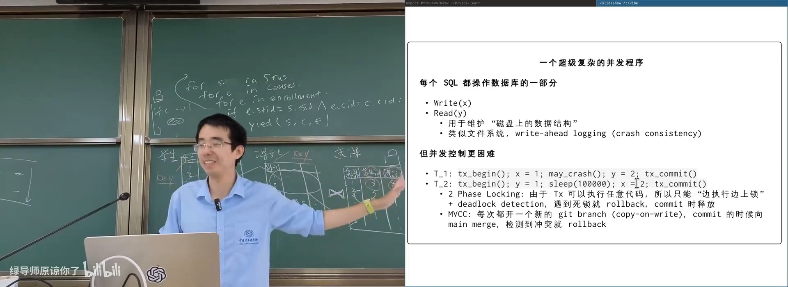

第二种方案是 Multiversion Concurrency Control（MVCC）。讲师用 Git 分支来类比：

- 数据库当前状态等价于 `main`；
- `tx_begin()` 等价于 checkout 一个新分支；
- 事务读自己的快照；
- 事务把自己的写入应用到分支；
- `tx_commit()` 尝试把它 merge 回 `main`；
- 如果没有冲突，多个事务都可以提交；
- 如果修改了同一行且无法自动解决冲突，其中一个事务必须回滚。

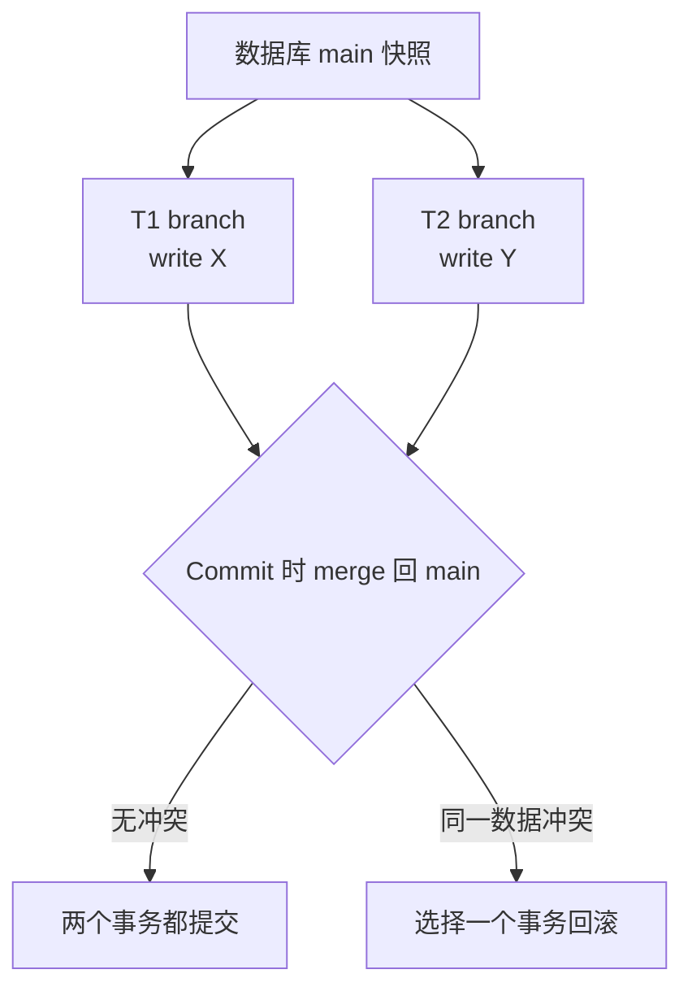

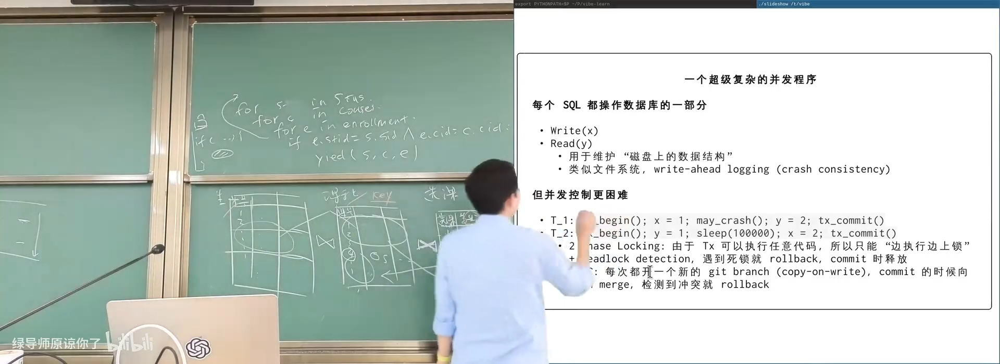

数据库不能像 Git 那样让人工解决所有 merge conflict，因为事务中可能包含任意计算。数据库只能根据读集合和写集合检测冲突，必要时回滚整个事务。这正是一个复杂但非常重要的工程问题。

### 2.9 SQLite：无处不在的小数据库

*(参考时间: 01:02:40)*

手机设置中的每一个开关都可以持久保存。实现方式并不是为每个偏好创建一个文件再反复 `fsync`，而是使用一个小型 SQLite 数据库。

SQLite 的特点：

- 是 C 语言实现的一个库，而不是独立数据库服务器；
- 整个数据库通常就是一个文件；
- 支持 SQL、事务和崩溃恢复；
- 零配置，发行版通常自带 `libsqlite3.so`；
- 内嵌在 Android、iOS、macOS、Chrome 等大量应用和系统中；
- 被称为世界上使用最广泛的数据库引擎。

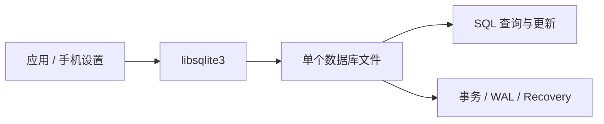

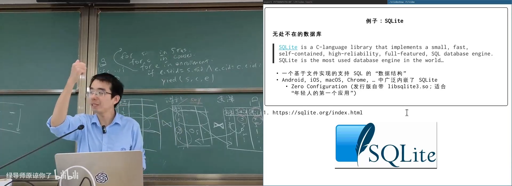

SQLite 让普通应用不必自己处理文件同步、事务提交和崩溃恢复。只要链接一个小型 C 库，就能获得成熟数据库的持久化能力。

---

## 3. 从 SQL 到 NoSQL、NewSQL 与向量数据库

### 3.1 国民级应用与 SQL 的压力

*(参考时间: 01:05:00)*

微信聊天记录本质上可以是数据库中的一张表：

```sql
SELECT *
FROM chat_records
WHERE (sender_id = @user_id1 AND receiver_id = @user_id2)
   OR (sender_id = @user_id2 AND receiver_id = @user_id1)
ORDER BY timestamp DESC
LIMIT 10;
```

这条查询在语义上完全正确。用户打开对话，只看到最近十条消息；数据库负责过滤、排序和截断。

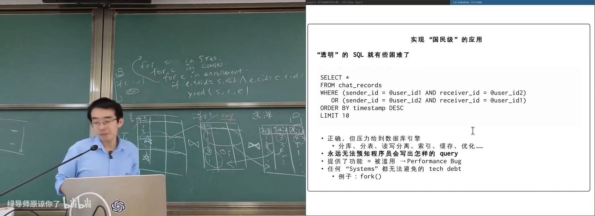

随着用户规模增长，问题不在 SQL 能不能表达，而在执行成本：

- 分库分表；
- 读写分离；
- 索引设计；
- 缓存；
- 复杂 Join 和排序；
- 查询计划选择。

更麻烦的是，数据库无法预先知道程序会写什么查询。一个订单页面可能涉及几十张表，一次查询需要多层 Join、日期过滤、排序和分页。功能越通用，越容易被滥用。


这不是某一个程序员的错误，而是任何通用 Systems 都难以避免的技术债。`fork()` 也曾因为接口过于通用而带来大量实现和使用成本。

### 3.2 做减法：Key-Value Store

*(参考时间: 01:10:00)*

如果完整 SQL 太重，可以做减法，只保留一个够用的数据结构：Key-Value Store。

```text
user:{uid}                 -> User JSON
user:{uid}:like_history    -> List
user:{uid}:like_count      -> Integer
```

用户信息可以序列化成 JSON 存到：

```text
user:1001
```

当一个用户选课或退课时，可以把事件追加到列表：

```text
enroll:2026:user:1001 -> [enroll OS2026, drop OS2026, ...]
```

需要得到最终选课列表时，从头重放事件；也可以缓存一个“当前选课列表”视图。


Append-only 结构具有重要优势：

- 通常比“读旧值、计算、写回”更容易实现；
- 更容易保证崩溃一致性；
- 可以并行追加多个日志片段，再拼接起来；
- 点赞、浏览历史和消息流天然适合追加。

### 3.3 Hash 分片与 LSM Tree

*(参考时间: 01:14:00)*

Key-Value Store 很容易横向扩展：

```text
shard = hash(key) % number_of_machines
```

一个足够好的哈希函数会把 Key 均匀映射到大量机器，实现自动负载均衡。由于数据主要是 append-only，存储引擎还可以使用 Log-Structured Merge Tree（LSM Tree）：

- 写入先进入内存 MemTable；
- 同时写 WAL 保证崩溃恢复；
- MemTable 写满后刷成不可变 SSTable；
- 后台合并 SSTable，清除旧版本；
- 读取时从新到旧查找多个层级。

```mermaid
flowchart LR
    WRITE["Write Key"] --> WAL["WAL"]
    WRITE --> MEM["MemTable"]
    MEM --> FLUSH["Flush"]
    FLUSH --> L0["Level 0 SSTable"]
    L0 --> L1["Level 1"]
    L1 --> L2["Level 2"]
    L2 --> READ["Read: newest to oldest"]
```


### 3.4 Redis：内存中的 Key-Value 与缓存

*(参考时间: 01:15:50)*

Redis 是一个内存 Key-Value 数据库，支持：

- String；
- List；
- Set；
- Hash；
- Sorted Set；
- Stream。

典型用途是缓存与写缓冲。例如统计点赞数：

1. 每次点赞先在内存计数器上加一；
2. 一分钟内可能累积数百万次；
3. 定时把增量合并到持久数据库；
4. 数据库只承受少量批量更新。

```mermaid
flowchart LR
    USERS["大量用户点赞"] --> REDIS["Redis Counter / List"]
    REDIS --> BATCH["周期性批量合并"]
    BATCH --> DB["持久数据库"]
```


这种设计的核心不是“数据永远不丢”，而是根据业务价值选择一致性等级。点赞数差几条通常可以接受，但所有点赞都执行完整事务会浪费大量资源。

### 3.5 NoSQL 与 NewSQL

*(参考时间: 01:17:40)*

人们仍然希望拥有比简单 Key-Value 更丰富的数据模型，于是出现多种折中：

- **MongoDB**：Document 数据库，Key 对应 BSON 文档，可以 append 消息、嵌套对象和数组；
- **Cassandra**：Column 数据库，使用 CQL，仍然保留 Table 风格，但只提供受控的 SQL 子集；
- **Google Spanner、TiDB、CockroachDB**：提供接近完整 SQL 的分布式数据库；
- **TiDB**：国产数据库出海的代表性案例之一。

例如 Cassandra 仍然可以写：

```sql
INSERT INTO messages
    (user_id, message_id, content, timestamp)
VALUES
    ('1234567', now(), message, toTimestamp(now()));
```

```mermaid
flowchart TD
    KV["Key-Value"] --> DOC["Document: MongoDB"]
    KV --> COL["Column: Cassandra"]
    KV --> NEWSQL["NewSQL: Spanner / TiDB / CockroachDB"]
    DOC --> SUBSET["更受控的查询能力"]
    COL --> SUBSET
    NEWSQL --> FULL["接近完整 SQL + 分布式扩展"]
```


这些系统希望保留 SQL 的易用性，同时通过受控接口、分片和分布式共识降低滥用风险。数据库设计的核心始终是取舍：给应用提供多少能力，系统就要承担多少复杂性和性能风险。

### 3.6 Vector Database：把语义变成距离

*(参考时间: 01:19:20)*

传统数据库按字段、Key 和关系查询；向量数据库保存 Embedding，并按距离寻找相似对象。

```mermaid
flowchart LR
    TEXT["文档 / 图片 / 代码"] --> MODEL["Embedding Model"]
    MODEL --> VEC["高维向量"]
    VEC --> VDB["Vector Database"]
    QUERY["查询内容"] --> QVEC["查询向量"]
    QVEC --> ANN["Approximate Nearest Neighbor"]
    VDB --> ANN
    ANN --> RESULT["语义相近的结果"]
```

课堂演示把课程提纲、每页幻灯片描述或每一讲的文档交给一个小型模型，生成高维向量。向量之间可以用：

- 点积；
- 余弦距离；
- 欧氏距离；

来衡量相似度。距离越近，通常意味着内容越相关。


讲师还展示了课程各讲的 Embedding 距离图：

- 并发相关的第 13 到第 21 讲聚在一起；
- 文件系统和数据库相关的第 24 到第 27 讲形成相近区域；
- 第 4 讲的 Agentic AI 内容比较像一座孤岛。


向量数据库的典型需求是：

- 存储数百万到上亿个向量；
- 每个向量可能有几千维；
- 给定查询向量，快速查找最近邻；
- 使用 ANN 近似算法换取可扩展性；
- 返回“最近”的文档、图片、商品或论文。

未来的数据系统很可能同时包含：

- 结构化表；
- Key-Value 索引；
- append-only 事件流；
- 向量索引；
- 全文索引。

每条记录都可以拥有一个语义向量，使系统既支持精确查询，也支持模糊的语义检索。

---

## 4. 总结：所有应用最终都是数据结构的 CRUD

*(参考时间: 01:22:20)*

这一课从“文件系统是磁盘上的数据结构”出发，一路走到数据库和向量检索。

```mermaid
flowchart TD
    FS["文件系统"] --> FILE["目录与文件"]
    FS --> MMAP["mmap + WAL"]
    FILE --> RDBMS["关系型数据库"]
    MMAP --> RDBMS
    RDBMS --> SQL["Table / Join / ACID"]
    SQL --> CONCURRENCY["2PL / MVCC / Recovery"]
    RDBMS --> KV["Key-Value"]
    KV --> REDIS["Redis / Cache"]
    KV --> NOSQL["MongoDB / Cassandra"]
    KV --> NEWSQL["Spanner / TiDB / CockroachDB"]
    RDBMS --> VECTOR["Vector Database"]
    VECTOR --> SEMANTIC["Embedding / ANN"]
```

核心结论：

- 应用程序把物理世界投影成一个可持久化的数据结构；
- 文件系统适合小规模、工具友好、Agent 友好的系统；
- mmap 和 WAL 可以直接在文件上实现自定义数据结构与恢复协议；
- 关系数据库把数据表达、查询优化、事务、并发控制和恢复封装成通用服务；
- SQL 的强大也使查询滥用成为长期存在的性能问题；
- NoSQL 通过减少接口能力换取扩展性；
- NewSQL 试图重新组合 SQL 与分布式能力；
- Vector Database 为 AI 应用提供语义检索基础设施。

无论技术形态如何变化，数据库的本质仍然是一个“非常非常好的数据结构”：它让应用程序不必反复发明持久化、并发和崩溃恢复，而是用统一接口管理不断变化的业务事实。

---

## 附：官方参考与延伸阅读

- [A Relational Model of Data for Large Shared Data Banks](https://dl.acm.org/doi/10.1145/362384.362685)
- [Single-Level Store](https://dl.acm.org/doi/10.1145/3477132.3483563)
- [Memory-Mapped Data Structures](https://jyywiki.cn/OS/demos/persistence/mmds)
- [CMU 15-445: Database Systems](https://15445.courses.cs.cmu.edu/)
- [SQLite 官方网站](https://sqlite.org/index.html)
- [Redis Streams](https://redis.io/docs/latest/develop/data-types/streams/)
- [Redis Transactions](https://redis.io/docs/latest/develop/interact/transactions/)
- [南京大学教务系统](https://ehallapp.nju.edu.cn/jwapp/sys/teacherJxrwApp/*default/index.do)

官方课程资料：

- [课程主页](https://jyywiki.cn/OS/2026/)
- [第 27 讲讲义：数据库系统](https://jyywiki.cn/OS/2026/lect27.md)
- [视频：27 - 数据库系统](https://www.bilibili.com/video/BV1eqEA6JEZA/)

> **版权与署名**：本讲课程材料由蒋炎岩（jyy）编写。课程讲义与幻灯片采用 [Creative Commons BY-NC 4.0](http://creativecommons.org/licenses/by-nc/4.0/) 许可；本电子书保留课程出处、作者署名与许可说明。
