# Agentic AI 和我们的未来：操作系统课程总结

> **课程**：2026 春季学期《操作系统原理》  
> **讲师**：蒋炎岩（jyy）  
> **官方课程主页**：<https://jyywiki.cn/OS/2026/>  
> **官方讲义**：<https://jyywiki.cn/OS/2026/lect30.md>  
> **视频来源**：[Bilibili BV1q2jh6FEhX](https://www.bilibili.com/video/BV1q2jh6FEhX/)  
> **版权说明**：课程讲义与幻灯片归蒋炎岩所有，采用 [Creative Commons BY-NC 4.0](http://creativecommons.org/licenses/by-nc/4.0/) 许可；本电子书是对课堂讲授的书面化重构，保留出处与许可说明。

## 导语：从操作系统课走向 Agentic AI 时代

*(参考时间: 00:00)*

这是课程的最后一讲。前半段回顾复习方法和整学期知识地图，后半段讨论一个更宏大的问题：当大模型和 Agent 持续 scaling，操作系统、大学教育和个人的未来会发生什么变化？

课程一开始就给出了操作系统的两种视角：

- **应用视角**：操作系统是一组管理硬件资源、支撑应用生态的 API；
- **硬件视角**：CPU 不认识操作系统，只严格按指令和规范执行，操作系统与硬件共同演化。

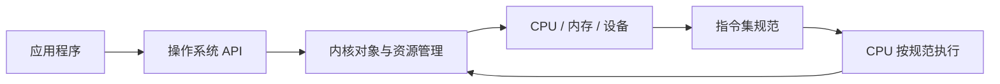

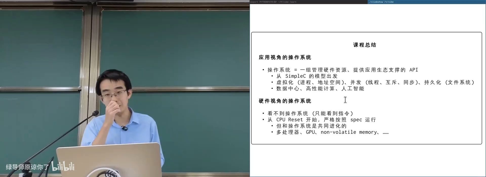

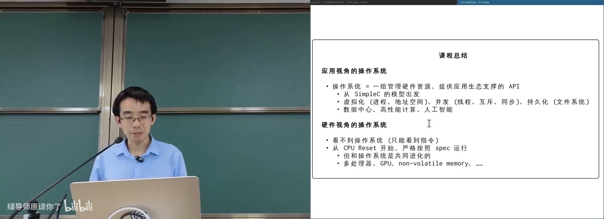

---

## 1. 怎样复习操作系统

### 1.1 从需求出发，而不是背事实

*(参考时间: 07:00)*

这门课真正希望留下的，不只是若干 API 和系统调用，而是一套 first principles：

1. 应用程序想做什么？
2. 操作系统能怎样提供这个能力？
3. 这个机制还能被怎样使用？
4. 如果让我重新设计，我会怎么做？

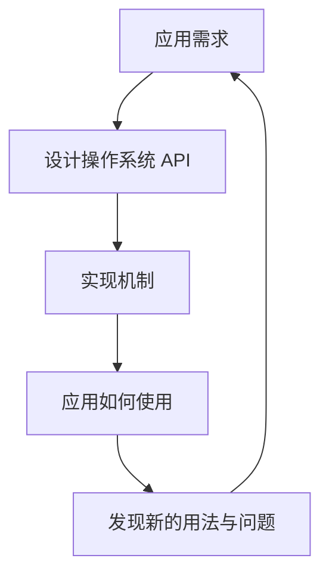

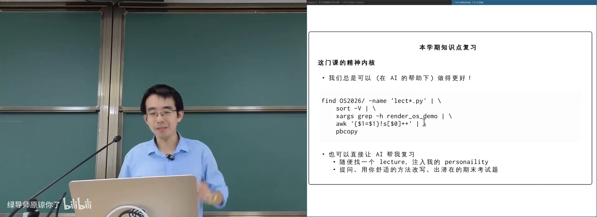

课程中的 demo 都围绕一个原则：计算机系统里没有魔法。只要行为异常，就一定能通过代码、系统调用、硬件状态和调度顺序解释。

### 1.2 让 Agent 帮你构建复习工具

*(参考时间: 09:30)*

课程内容全部以代码和 Markdown 保存，因此可以被 Agent 直接读取、执行、分析和重组。最有效的方式不是只下载课件，而是让 Coding Agent：

- 克隆课程仓库；
- 整理目录；
- 编译运行所有 demo；
- 提取每节课的知识点和代码；
- 生成不同粒度的复习提纲；
- 针对每个知识点生成模拟题；
- 交互式追问和验证。

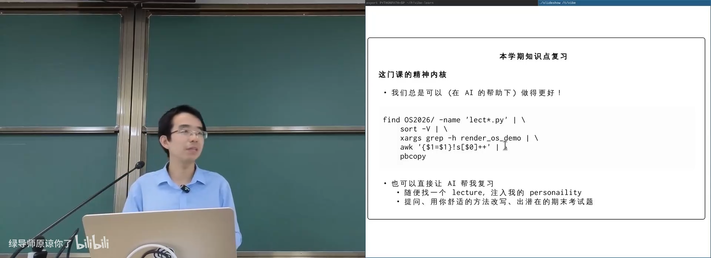

### 1.3 Unix Philosophy：组合小工具完成大任务

*(参考时间: 12:00)*

Windows 生态偏向功能完整的单一应用，例如 Office 或 Adobe 全家桶。Unix 更强调让每个工具做好一件事，再通过管道组合。

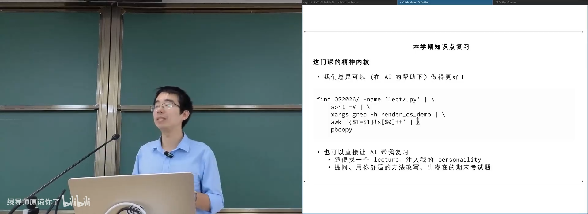

例如，从所有课件中收集课程 demo 可以写成：

```bash
find OS2026/ -name 'lect*.py' |
  sort -V |
  xargs grep -h render_os_demo |
  awk '{$1=$1}!s[$0]++' |
  pbcopy
```

这条管道依次完成：

1. 找到课件文件；
2. 按讲次自然排序；
3. 搜索课程 demo；
4. 去除重复行；
5. 放入剪贴板。

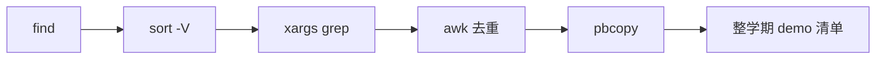

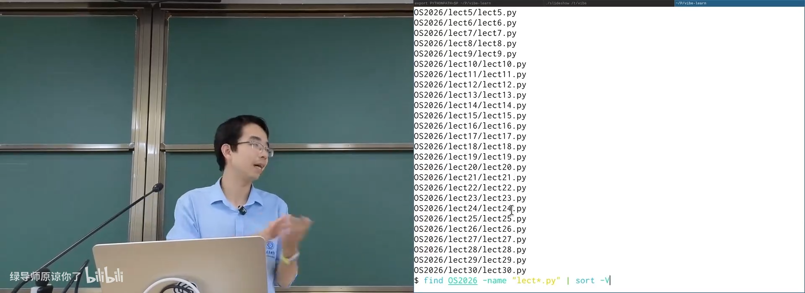

这也是 Agent 时代非常重要的能力：工具之间通过文本、文件和系统调用合作，而不是把所有逻辑封死在单个应用内。

### 1.4 用 AI 生成模拟题，但要保留判断

*(参考时间: 20:30)*

课堂现场让 Agent 根据课件出一套模拟卷，内容覆盖了：

- 并发控制与锁；
- `fork()` 对进程状态的复制；
- 文件描述符和偏移量继承；
- 进程地址空间；
- 万能的条件变量同步方法；
- 文件系统崩溃一致性；
- 资源泄漏和线程安全的数据结构。

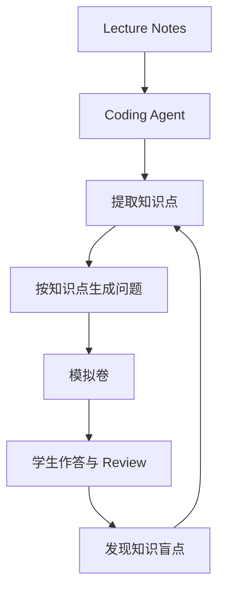

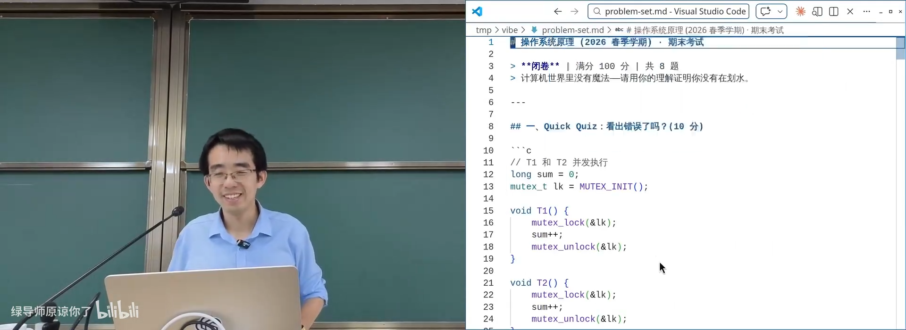

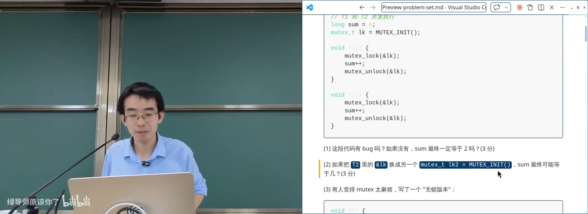

但 AI 也有 alignment 问题。它认为重要的内容，未必和讲师的考试重点一致。正确用法是把它当作高吞吐的练习生成器和审阅器，而不是放弃自己的判断。

### 1.5 对照练习：把系统重新设计一遍

*(参考时间: 24:00)*

复习一个机制时，可以执行以下循环：

```text
理解需求
  -> 自己设计一个方案
  -> 对照真实操作系统
  -> 找出差异和原因
  -> 用代码和实验验证
```

例如 `fork()` 会复制“所有状态”，不仅是程序变量，还包括：

- 地址空间；
- 文件描述符；
- 打开文件对象和偏移量；
- 信号处理状态；
- 操作系统对象引用。

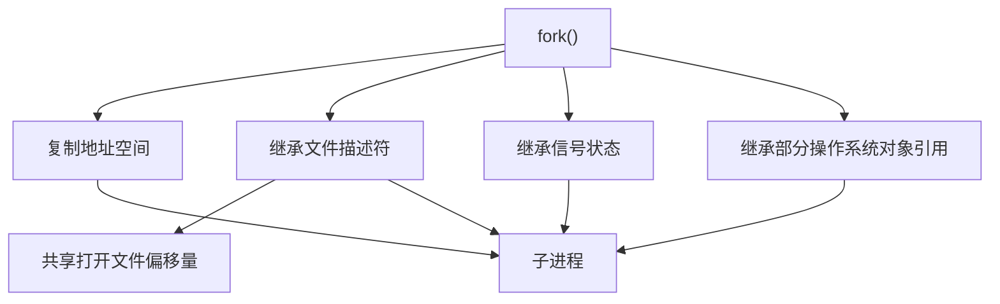

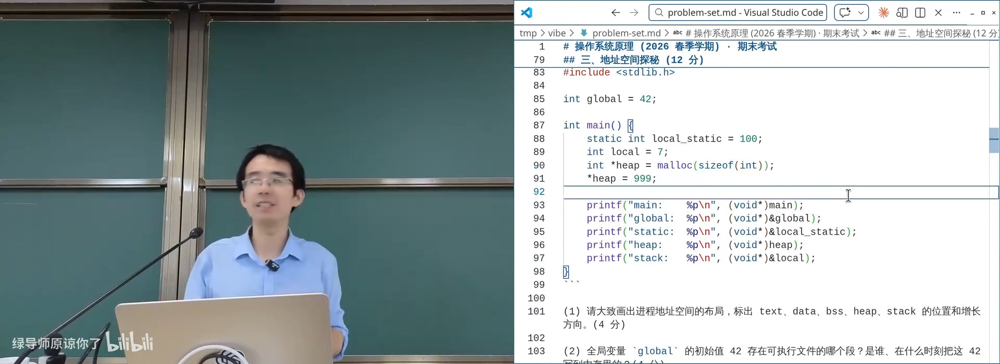

---

## 2. 整学期知识地图

### 2.1 从数字电路到最小操作系统

*(参考时间: 34:30)*

课程从数字逻辑开始：时钟、导线、NAND 和寄存器构成数字系统，状态在每个时钟周期离散更新。随后：

- 用 C 实现数字电路模拟器；
- 实现 single-header RISC-V 模拟器；
- 运行无 MMU 的 Linux；
- 理解 CPU Reset 后的初始状态；
- 调试 SeaBIOS 和 OpenSBI；
- 构建最小可执行文件和最小操作系统。

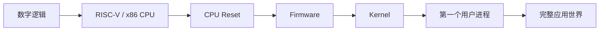

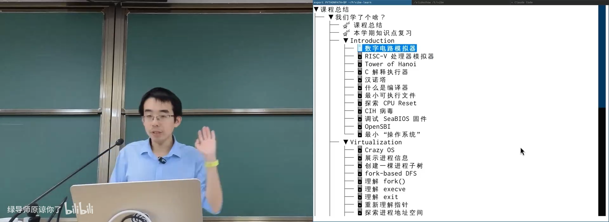

### 2.2 程序、编译器与系统调用边界

*(参考时间: 37:30)*

汉诺塔展示了 C 语言“顺序执行”和全局副作用的重要性。把递归程序改写成 SimpleC 后，可以明确看到：

- 每个函数调用对应一个栈帧；
- 栈帧必须记录执行位置；
- 函数调用是状态机的一次迁移；
- 编译器可以重写语义等价的状态迁移；
- 系统调用是编译器无法穿透的边界。

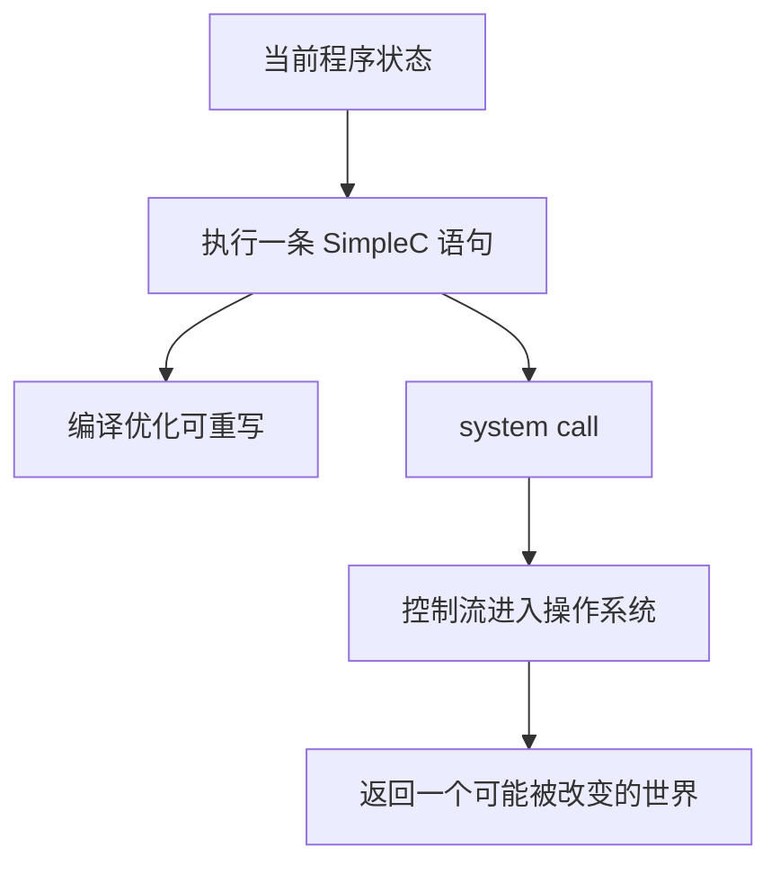

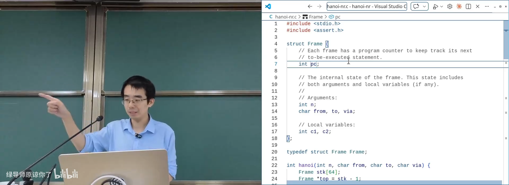

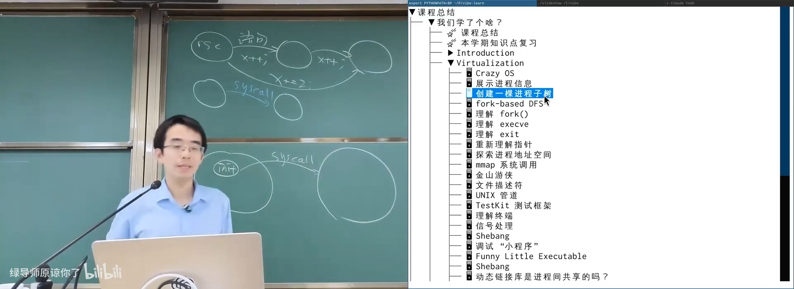

系统调用像一次麻醉手术：进程在调用期间无法感知外部世界，返回时地址空间、权限和对象状态都可能已经改变。

### 2.3 虚拟化：进程、地址空间与对象

*(参考时间: 40:30)*

Virtualization 部分从一个 init 进程开始，通过 `fork`、`execve`、`exit` 等系统调用构建进程树。

进程最重要的资源是虚拟地址空间。课程中的实验包括：

- 自行实现 `malloc` / `free`；
- 使用 `mmap` 按需分配大块内存；
- 读取和修改其他进程的地址空间；
- 调试一个最简单 C 程序的每条指令；
- 通过文件描述符访问操作系统对象。

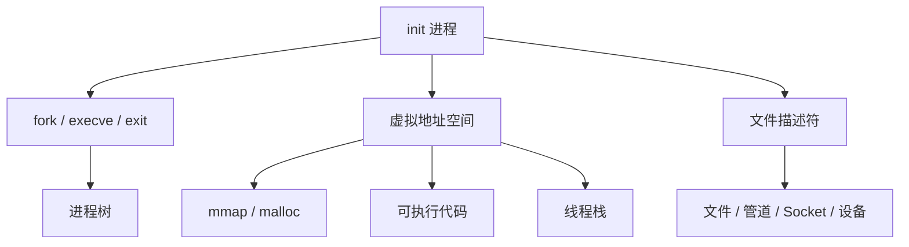

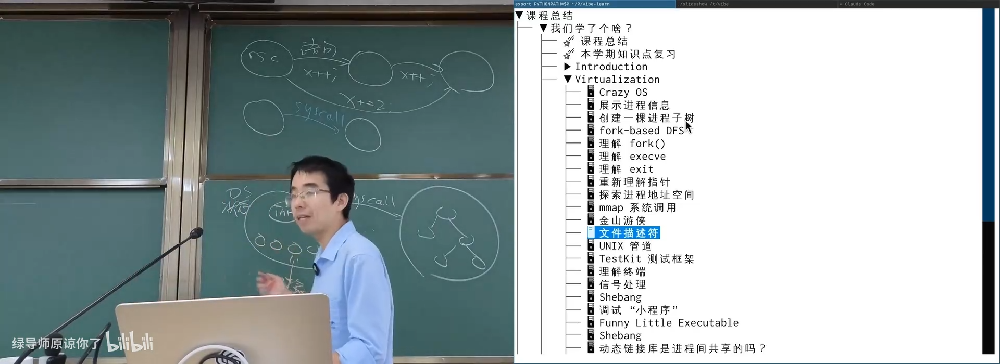

### 2.4 Everything is a File 与动态链接

*(参考时间: 44:30)*

文件描述符是进程访问操作系统对象的句柄。Linux 把文件、管道、终端、Socket、设备等尽可能统一成文件接口。

动态链接进一步暴露了系统边界中的“可玩性”：

- 解释器可以在 libc 前加载其他库；
- 符号可以被预加载库覆盖；
- `LD_PRELOAD` 可以替换 `read`、`gettimeofday` 等函数；
- 在应用和真实内核之间叠一层“模拟操作系统”。

课堂演示的“变速齿轮”通过覆盖时间相关 API，让应用看到十倍速度的虚拟时间。

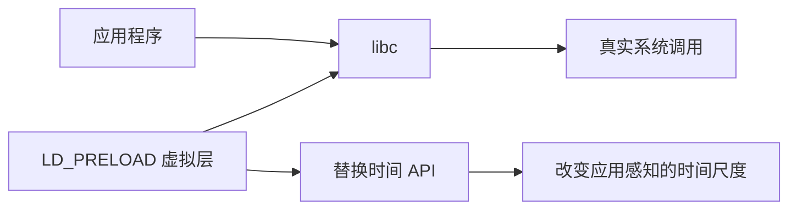

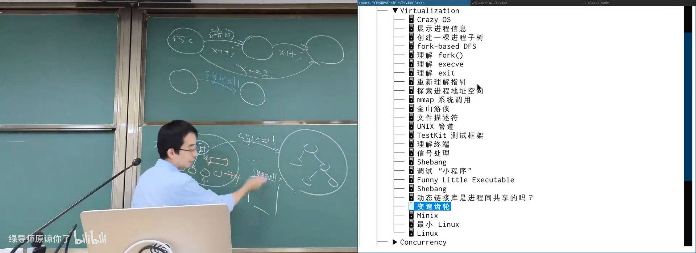

### 2.5 并发：打开魔鬼的盒子

*(参考时间: 47:30)*

为了让多个处理器并行工作，进程内部出现多个共享内存的线程。共享内存让通信成本极低，同时引入数据竞争。

课程从“山寨支付宝”的竞态开始，逐步讲到：

- 线程、栈和线程局部存储；
- mutex、原子指令和自旋锁；
- 宽松内存模型；
- Peterson 算法及其局限；
- 生产者消费者；
- 条件变量和信号量；
- 死锁、lockdep 和 ThreadSanitizer；
- 协程、Go channel、GPU 和 CUDA；
- 指令级并行和 SIMT。

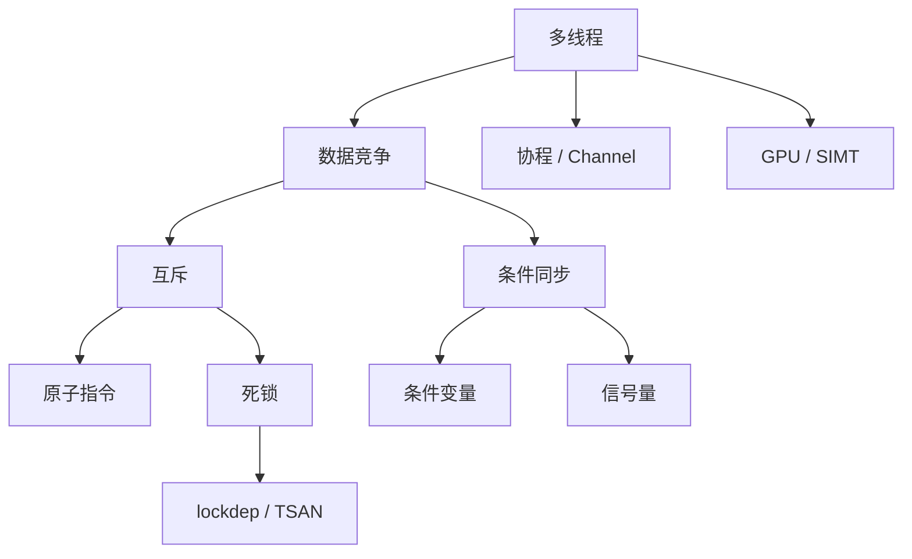

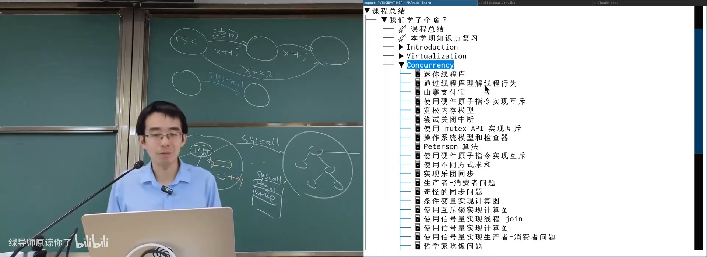

### 2.6 I/O、设备和持久化

*(参考时间: 50:30)*

操作系统统一管理 I/O 设备。设备驱动把系统调用翻译成设备寄存器和协议操作，再通过 `struct file_operations` 暴露成文件接口。

课程覆盖了：

- GPIO LED；
- 打印语言 PostScript；
- 设备驱动和 KVM；
- WebCam 与 V4L2；
- Linux Block I/O；
- 磁盘、NVMe 和 SSD；
- 文件系统、FAT、ext4；
- WAL、Crash Consistency Checker；
- LVM、OverlayFS、符号链接和 mmap 数据结构。

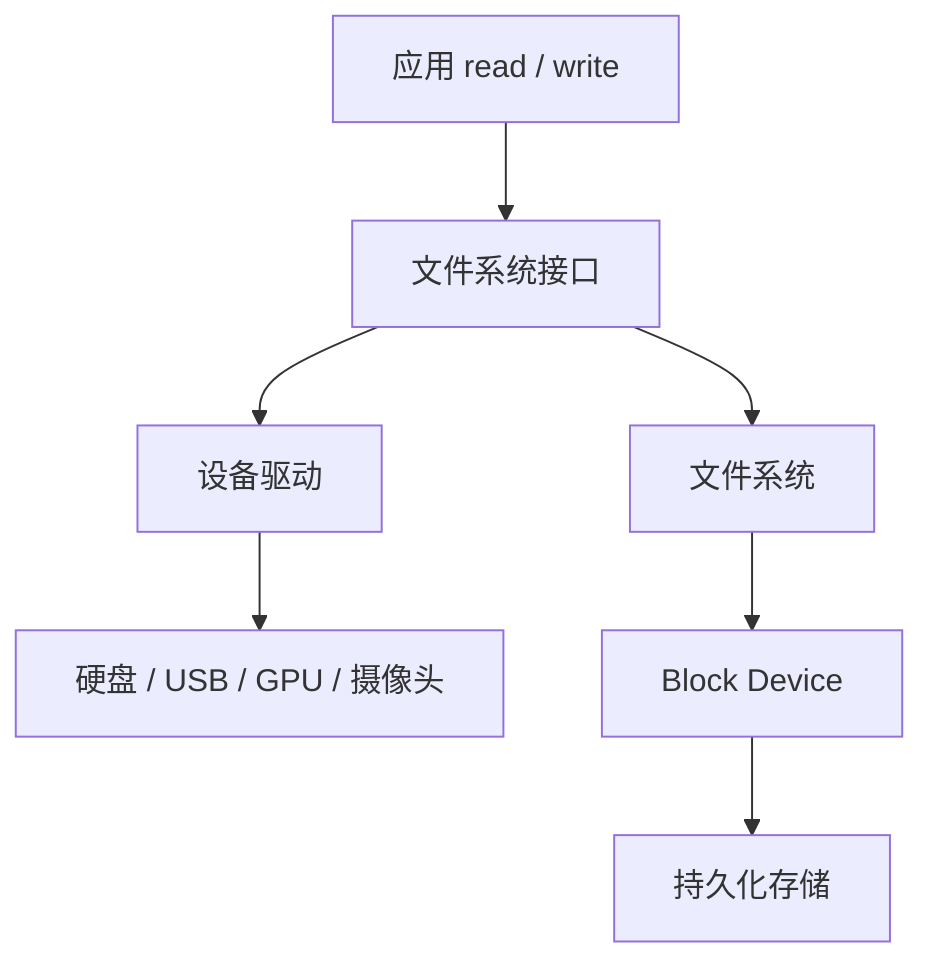

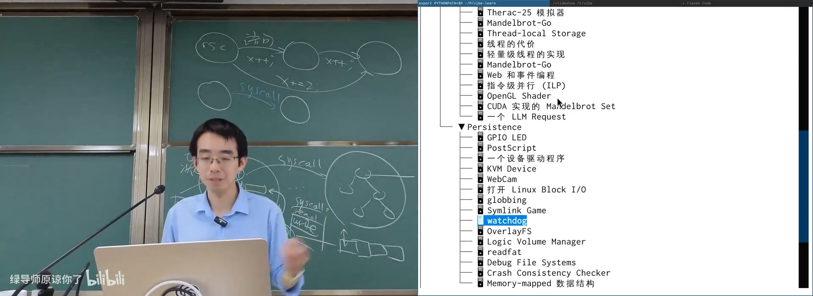

### 2.7 Systems 的核心：好抽象

*(参考时间: 53:30)*

操作系统的主题可以概括为：

> 用好的抽象隐藏底层复杂性，同时尽可能保留底层能力。

每一层抽象都在做两件事：

- 对上层提供干净模型；
- 对下层保留足够控制能力。

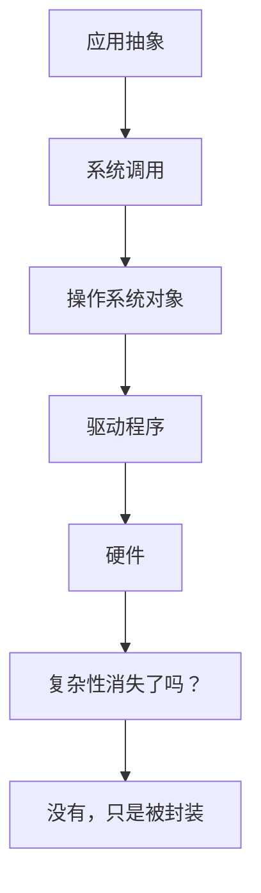

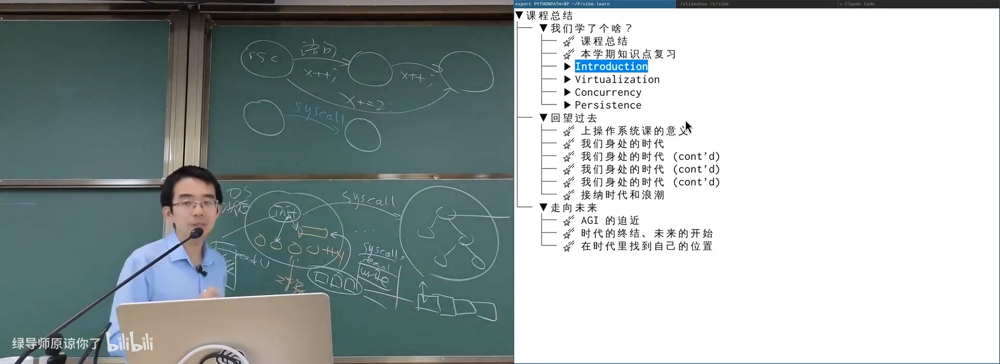

---

## 3. 回望过去：技术与时代的 Scaling

### 3.1 Teaching is a Powerful Tool to Learn

*(参考时间: 55:30)*

讲师引用费曼的观点：在课堂上重新思考已经清楚的基本问题，本身就能产生新的研究方向。每一年重新讲授操作系统，都可能发现更好的组织和更深刻的联系。

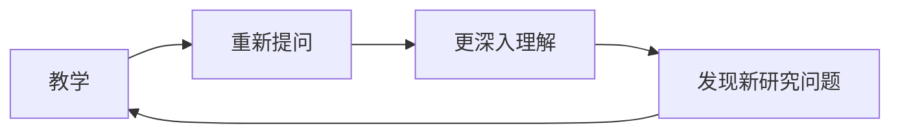

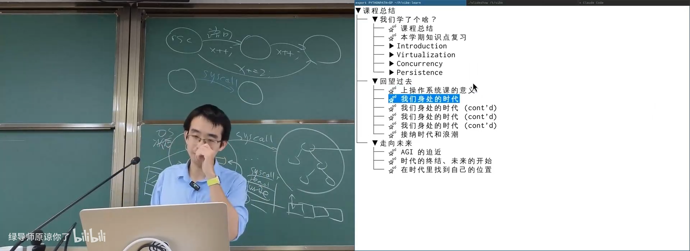

### 3.2 历史突破不是偶然

*(参考时间: 57:30)*

课堂把多项技术突破放在 scaling 曲线中：

- 1997 年 DeepBlue 击败国际象棋世界冠军；
- 1998 年 Google 建立在存储密度增长之上；
- Intel、NVIDIA 分别抓住 CPU 和并行计算浪潮；
- OpenAI 建立在大规模语言模型 scaling 上。

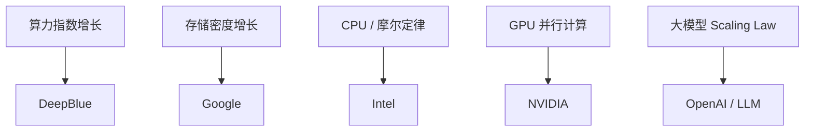

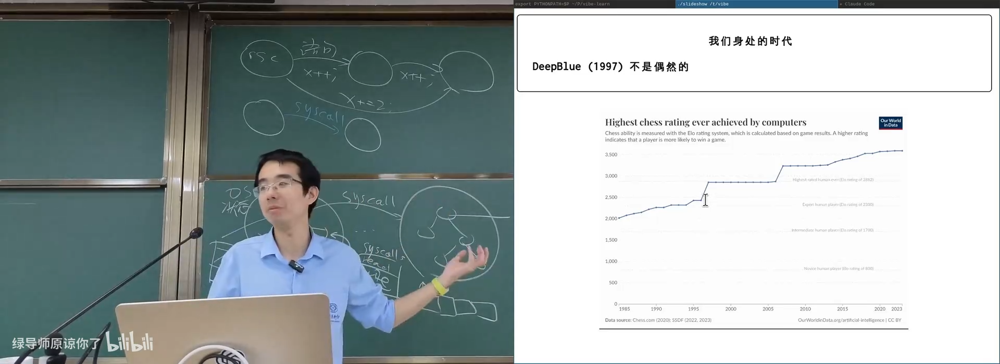

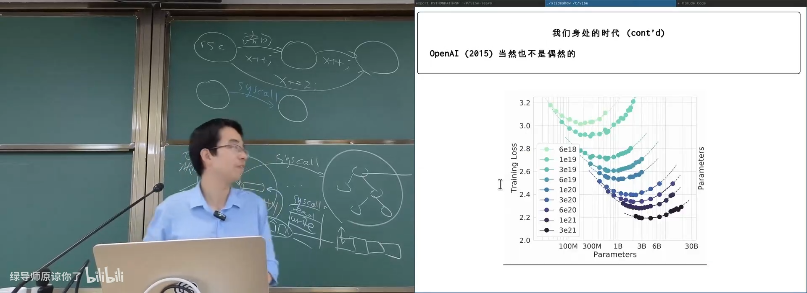

每当某个关键能力开始指数增长，相关领域就可能发生结构性变化。

### 3.3 从事实记忆转向 First Principles

*(参考时间: 01:01:00)*

课程尤其强调从需求推导设计：

```text
应用需要加载二进制
  -> 进程地址空间需要若干区域
  -> 可执行文件必须描述这些区域
  -> ELF 文件格式自然出现
```

```text
应用需要动态加载库
  -> 需要符号解析与延迟绑定
  -> 动态链接器和 PLT/GOT 自然出现
```

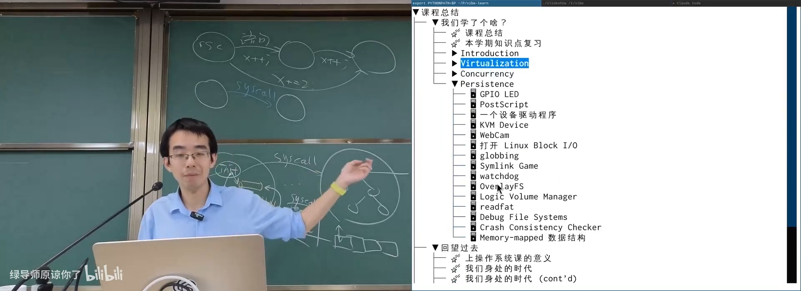

Git 是另一个例子。不要只记 command，而要从需求理解它：

- 开发者需要本地版本管理；
- 不同开发者之间需要同步；
- 快照可以表示为 tree of blobs；
- 提交形成 commit DAG；
- branch、stash、worktree 都可以从数据结构自然推导。

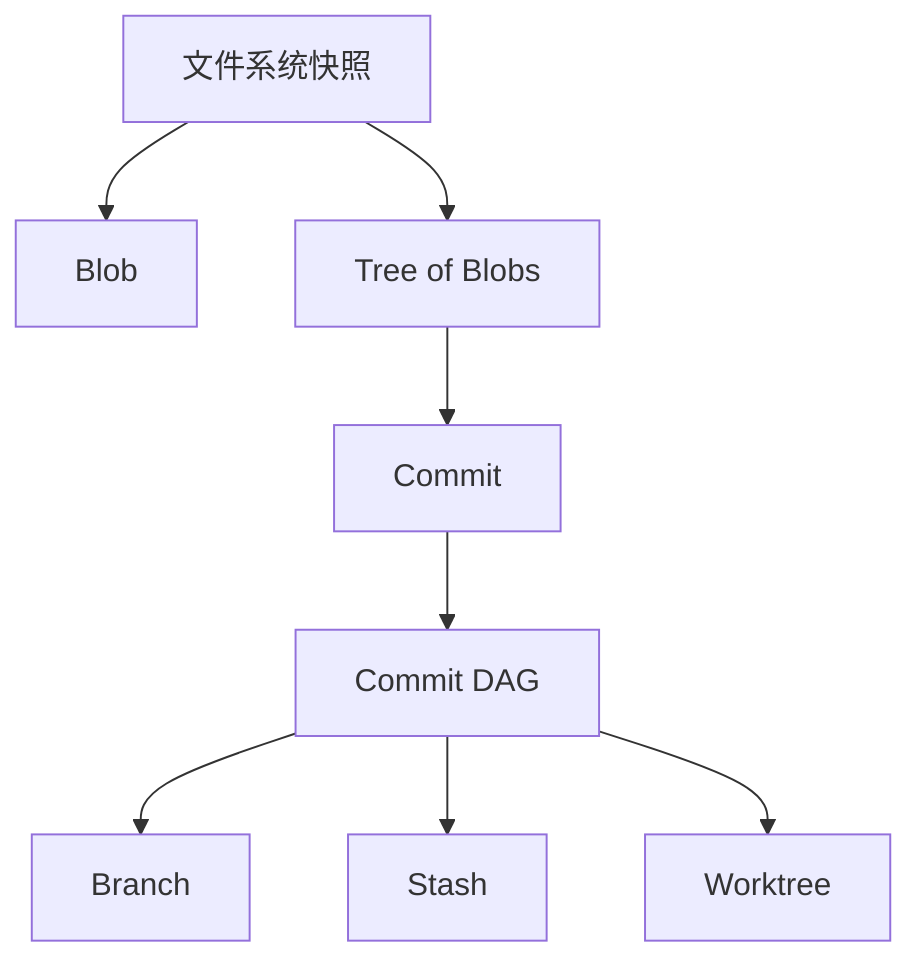

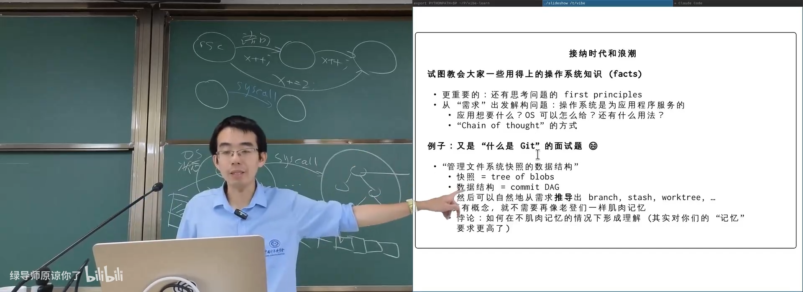

---

## 4. 走向未来：Agentic AI 与 AGI

### 4.1 三个阶段的能力放大

*(参考时间: 01:06:20)*

大模型的能力增长可以分成三类 scaling：

#### Pretraining-time scaling

更多高质量数据、更大参数、更强基础模型。

#### Post-training scaling

通过监督、强化学习和可验证反馈提高特定能力。代码具有清晰反馈信号，因此成为模型能力提升的重要训练场。

#### Test-time scaling

给模型更多思考时间、采样次数、检查和重试机会。模型可以在推理阶段继续搜索、验证和改进答案。

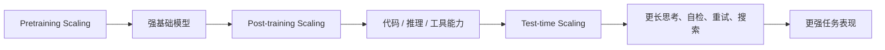

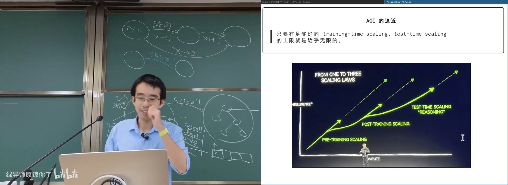

可以把高中到大学类比为：

- 高中阶段是广泛预训练；
- 大学专业方向是后训练和微调；
- 考试时的复盘与检查是 test-time scaling。

### 4.2 用“穷尽”解决难题

*(参考时间: 01:08:30)*

当 AI 面对陌生数学题时，可以把问题与一个巨大的题集进行匹配，让模型遍历相似题目和解答，再组合已有思路。

核心观察是：

> 很多“难题”并没有真正新的结构，只是已有技巧的新组合。

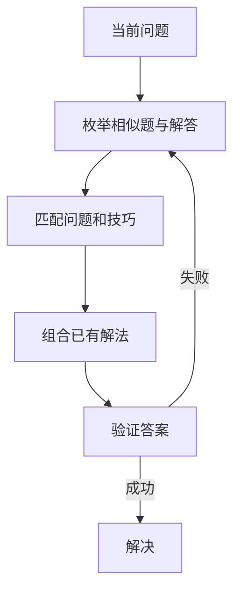

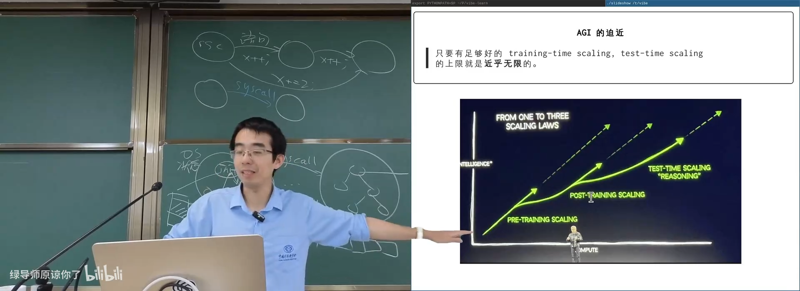

只要有足够算力和反馈，这种过程可以持续扩展。

### 4.3 教育和工作的结构变化

*(参考时间: 01:10:30)*

讲师的判断是：AGI 会逐渐削弱传统“服从性教学”和“信息差权力”的价值。

- 学生可以获得适合自己的个性化教学；
- Agent 可以补平普通人之间的知识信息差；
- 过去依赖记忆、流程和资历的优势会缩小；
- “比别人不菜一点”不再足以稳定胜出；
- 真正稀缺的是想象力、提出问题、判断和持续学习能力。

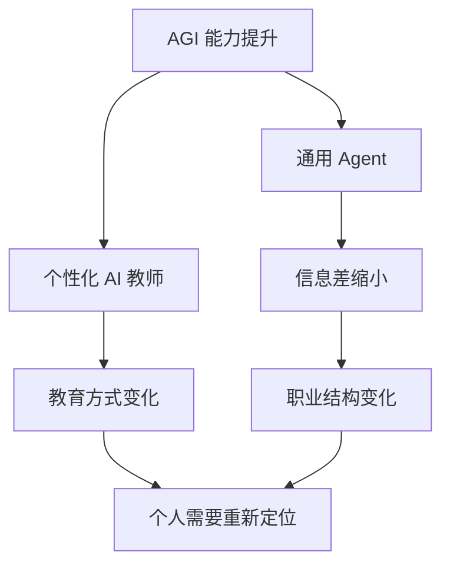

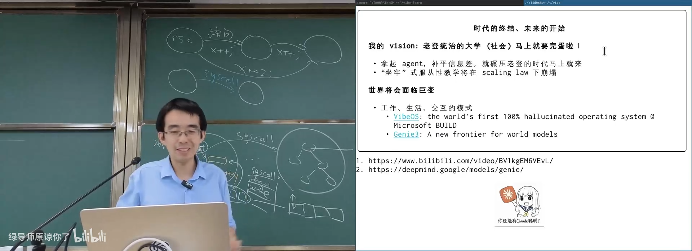

未来的竞争不再是简单记忆和重复执行，而是能否定义问题、构建 Agent 工作流、判断结果并探索真正的未知。

### 4.4 VibeOS：完全由模型幻觉出来的操作系统

*(参考时间: 01:13:00)*

课堂播放了微软 BUILD 的一个演示项目 VibeOS。它是一个虚拟机镜像，界面包含记事本、计算器、浏览器和应用商店。

特别之处在于：

- 没有传统意义上的应用代码；
- 按钮、事件处理和界面逻辑都由模型实时生成；
- 网页内容和搜索结果也是模型幻觉；
- 甚至可以继续模拟嵌套操作系统和终端。

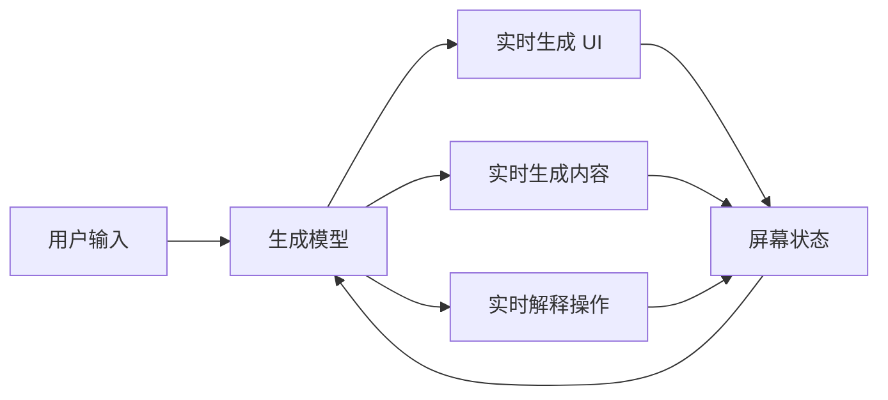

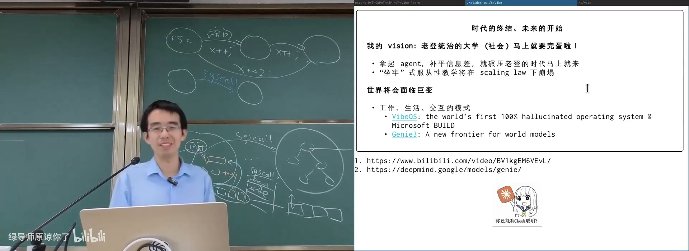

这类系统目前更像原型，但它提示了一个方向：

- 用户只需要表达意图；
- 模型生成界面、逻辑和数据；
- 世界模型实时维持环境一致性；
- 软件从“预先编写”转向“即时生成”。

### 4.5 Generative Software Engineering

*(参考时间: 01:22:20)*

下一步课程从传统 Web Coding 改名为 Generative Software Engineering，关注：

- 使用国产一线模型构建应用；
- Agent Harness 设计；
- 工具、Skills 和 Subagents；
- 自动化评测与反馈；
- 如何把复杂任务拆给模型；
- 如何在 Agent 时代获得可信结果。

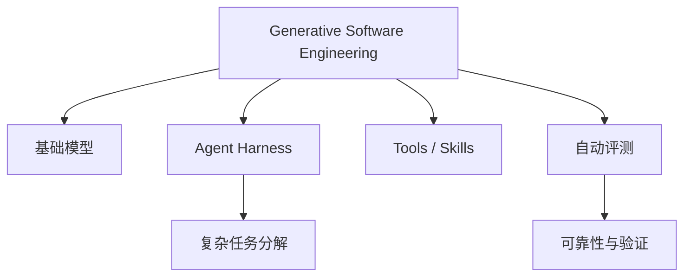

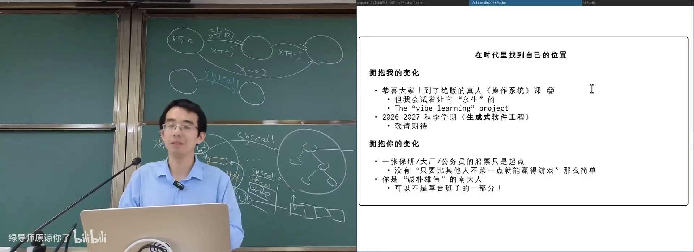

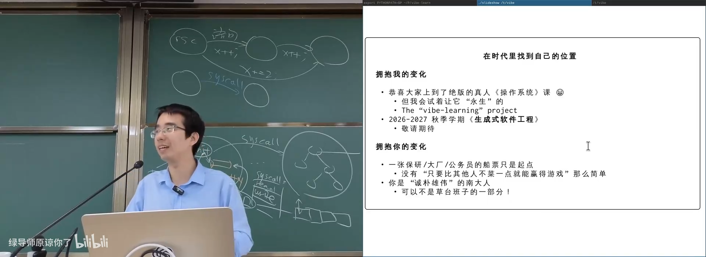

---

## 5. 总结：操作系统课留下的不是一张船票

*(参考时间: 01:23:30)*

这门课从 API、进程、地址空间、并发和文件系统出发，最终回到一个更普遍的问题：如何在快速变化的世界中保持理解和创造能力。

```mermaid
flowchart TD
    OS["操作系统"] --> ABSTRACT["抽象"]
    OS --> CONCURRENCY["并发"]
    OS --> PERSIST["持久化"]
    OS --> SECURITY["安全"]
    ABSTRACT --> SYSTEMS["Systems Thinking"]
    CONCURRENCY --> SYSTEMS
    PERSIST --> SYSTEMS
    SECURITY --> SYSTEMS
    SYSTEMS --> AI["Agentic AI"]
    AI --> FUTURE["重新定义学习、工作与软件"]
```

核心结论：

- 操作系统是应用需求、硬件能力和抽象设计之间的桥梁；
- 真正应该掌握的是 first principles，而不是孤立事实；
- Unix 哲学与 Agent 工作流高度契合；
- Pretraining、post-training 和 test-time scaling 正在共同推动 AGI；
- 信息差和服从性学习的价值会下降，问题定义、判断和想象力更加重要；
- VibeOS 展示了“软件即时生成”的可能性，但可靠系统仍需要操作系统、抽象、验证和工程约束；
- 大学、工作和个人发展的游戏规则都会发生变化。

课程结束时最重要的不是拿到一张保研、大厂或公务员的船票，而是理解船票只是起点。面对快速 scaling 的 AI，每个人都需要找到自己的兴趣、判断和长期方向。

---

## 附：课程 Demo 与延伸资料

### Introduction

- [数字电路模拟器](https://jyywiki.cn/OS/demos/intro/logisim)
- [RISC-V 处理器模拟器](https://jyywiki.cn/OS/demos/intro/mini-rv32ima)
- [探索 CPU Reset](https://jyywiki.cn/OS/demos/intro/cpu-reset)
- [最小可执行文件](https://jyywiki.cn/OS/demos/intro/minimal)
- [最小操作系统](https://jyywiki.cn/OS/demos/intro/os-minimal)

### Virtualization

- [理解 fork()](https://jyywiki.cn/OS/demos/virtualization/fork-demo)
- [进程地址空间](https://jyywiki.cn/OS/demos/virtualization/addr-space)
- [mmap 系统调用](https://jyywiki.cn/OS/demos/virtualization/mmap)
- [UNIX 管道](https://jyywiki.cn/OS/demos/virtualization/pipe)
- [动态链接与加载](https://jyywiki.cn/OS/demos/virtualization/bloat)

### Concurrency

- [山寨支付宝](https://jyywiki.cn/OS/demos/concurrency/alipay)
- [条件变量与生产者消费者](https://jyywiki.cn/OS/demos/concurrency/producer-consumer)
- [死锁演示](https://jyywiki.cn/OS/demos/concurrency/deadlock)
- [ThreadSanitizer](https://jyywiki.cn/OS/demos/concurrency/tsan)
- [CUDA Mandelbrot](https://jyywiki.cn/OS/demos/concurrency/mandelbrot-cu)

### Persistence

- [文件描述符](https://jyywiki.cn/OS/demos/virtualization/filedesc)
- [Memory-mapped 数据结构](https://jyywiki.cn/OS/demos/persistence/mmds)
- [Crash Consistency Checker](https://jyywiki.cn/OS/demos/persistence/ccheck)
- [OverlayFS](https://jyywiki.cn/OS/demos/persistence/overlay)
- [逻辑卷管理 LVM](https://jyywiki.cn/OS/demos/persistence/lvm)

### 课程与未来方向

- [课程主页](https://jyywiki.cn/OS/2026/)
- [第 30 讲讲义：课程总结](https://jyywiki.cn/OS/2026/lect30.md)
- [VibeOS 演示](https://www.bilibili.com/video/BV1kgEM6VEvL/)
- [Genie 3 World Model](https://deepmind.google/models/genie/)

> **版权与署名**：本讲课程材料由蒋炎岩（jyy）编写。课程讲义与幻灯片采用 [Creative Commons BY-NC 4.0](http://creativecommons.org/licenses/by-nc/4.0/) 许可；本电子书保留课程出处、作者署名与许可说明。
